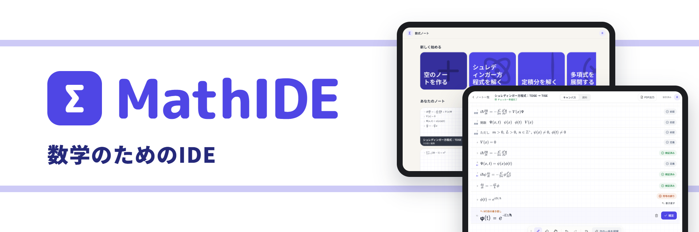
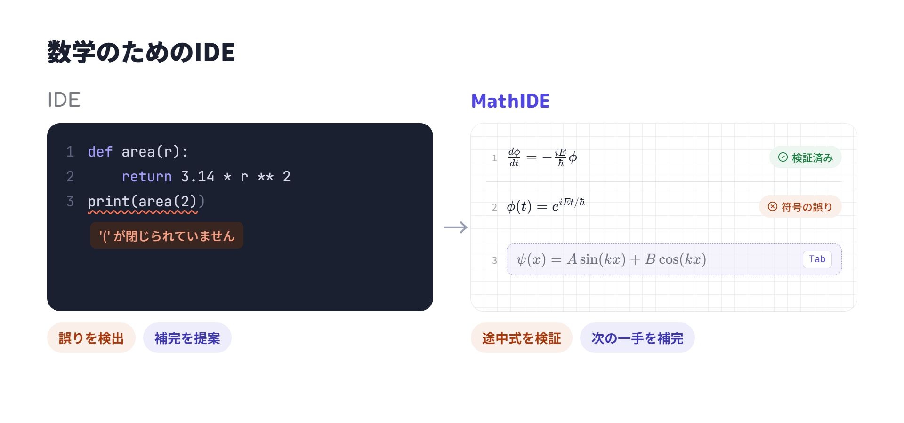
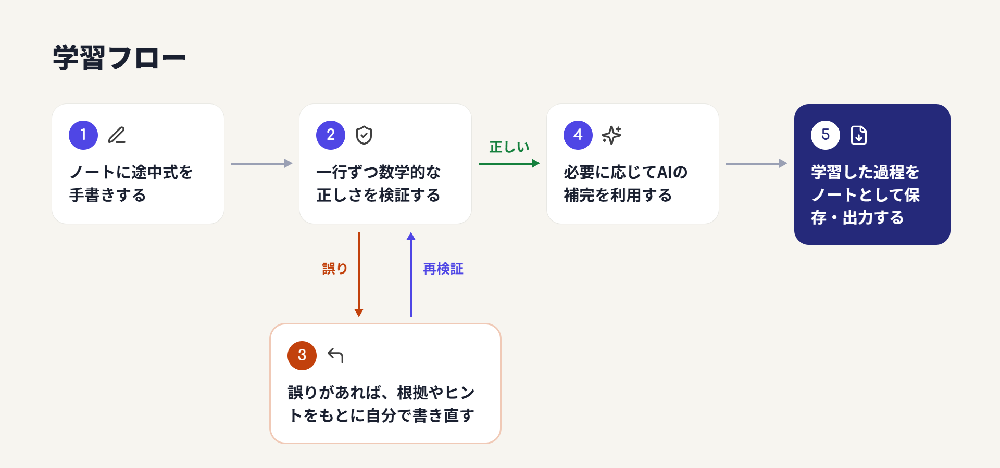
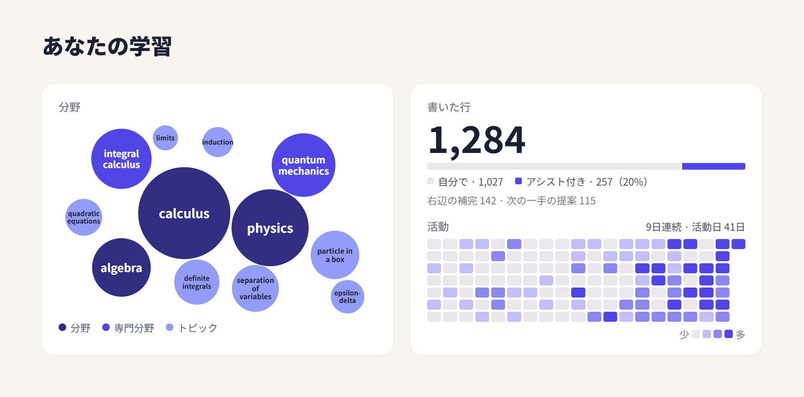
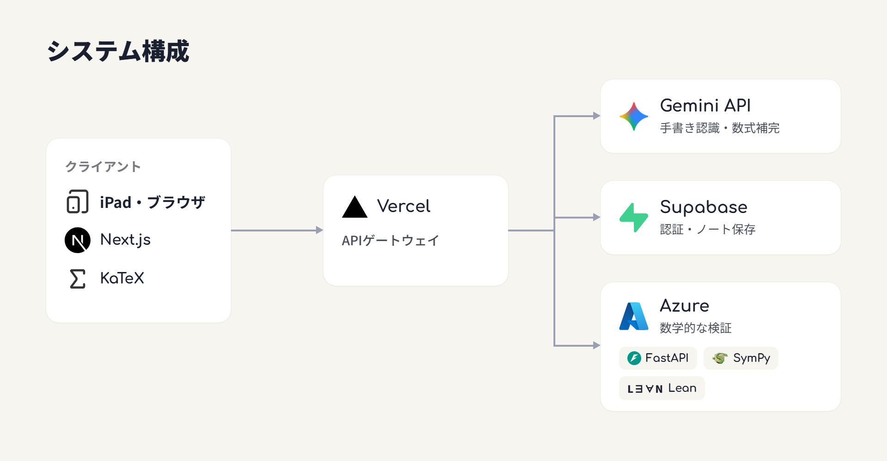

# MathIDE

学習支援 × Tech: MathIDEは、大学数学の学習を支援する手書きノートアプリです。途中式の検証やAIによる数式補完を通して、自分で考えることと、学習の効率化を両立します。

**以下の動画（音声あり）!**

https://github.com/user-attachments/assets/8e911532-a6e5-47a5-88d1-2320b7d7adfd

[**デモURL (http://ng2616.vercel.app/)!**](http://ng2616.vercel.app/login)

## 1. 背景と課題

### 開発の経緯

開発メンバーが高専から大学へ編入した際、講義の難解さや課題の多さに驚きました。大学数学の理解には時間がかかり、課題に追われるなかで、理解を諦めて生成AIに解答を任せてしまうこともありました。

しかし、完成された解答を得ても、問題を解くための理解は得られません。一方で、すべてを自力で解くには時間が足りません。

### ターゲットユーザー

基礎的な大学数学の学習に悩む、多忙な理系学部生。

数学を理解したいという意欲はありながら、講義や課題に追われ、十分な学習時間を確保できない学生を想定しています。

### 解決したい課題

- 大学数学の理解には時間がかかる
- 時間が足りず、生成AIに解答を任せてしまう
- 答えは得られても、計算過程を十分に理解できない

理解することを諦めずに、自分で解き進める過程を効率化したい。

## 2. 解決へのアプローチ

### 理想とする学習環境

学生自身が考えることを妨げず、必要な場面で適切な支援を受けられることが重要だと考えました。

- 途中式をその都度検証し、誤りに早く気づける
- わからない部分は、答えではなく段階的なヒントをもとに考え直せる
- 理解できている計算や煩雑な作業は、AIによる補完で効率化できる

ただし、補完に頼りすぎれば、自分で考える機会を失ってしまいます。そこで、ヒントと補完を必要に応じて使い分け、AIにどこまで頼るかを学生自身が選べる設計としました。補完も自動では確定せず、採用するかどうかは学生が判断します。

### 数学のためのIDE

## 3. MathIDEの紹介

### 製品概要

MathIDEは、手書きによる数学の学習に、途中式の検証・ヒント・補完を組み込んだノートアプリです。

### 学習フロー

### 主な機能

- 手書き数式の認識・検証
    - 手書きした数式を認識し、前の行との整合性を検証する
- 誤りの指摘と段階的なヒント
    - 誤りの種類や数学的な根拠、反例を提示する
    - 答えを直接示さず、学生自身による書き直しを促す
- AIによる数式補完
    - 途中式の右辺や次の一手を提案する
    - 候補は検証され、学生が採用するかを選択できる
- ノートの入出力
    - 演習プリントを読み込める
    - ノートを保存する
    - 記入したノートをレポートとしてPDFにエクスポートする

## 4. 既存サービスとの差別化

### 既存サービスの特徴

| サービス | 主な特徴 | 本プロダクトが差別化できる点 |
| --- | --- | --- |
| ChatGPT | 問題に対する解答・解説の生成 | 手書きの途中式と検証結果を行ごとに結びつけ、つまずいた箇所を可視化 |
| Photomath | 撮影した問題の解答・途中式の提示 | 解法の提示が中心で、自力で解く過程への支援が限定的 |
| Goodnotes | 数式計算、AIによる指導、専用演習での途中式検証 | 途中式の段階ごとの検証が得意。計算過程のミスを指摘できる |

特に、Goodnotesは、MathIDEと重複する機能を備えています。

- Math Assist：ノート上での手書き数式の認識・計算
- Teach Me：選択した問題に対するAIの段階的な指導
- Interactive Exam Practice：専用の演習問題における途中式の検証

### MathIDEの差別化

MathIDEでは、学生自身の解法に沿った検証・ヒントによる自力での修正・補完による効率化を、一連の学習体験として統合することを重視しています。

- 学生が書いた途中式を、自動で一行ずつ検証する
- 誤りを勝手に修正せず、根拠やヒントを提示する
- AIによる補完候補にも数学的な検証を適用する

### 学習の振り返り

ホーム画面では、これまでの学習をまとめて振り返ることができます。

自分で書いた行とAIの補完を利用した行を分けて示すことで、AIにどこまで頼っているかを学生自身が把握できます。

## 5. 実用化の可能性

### 想定する利用シーン

大学の講義・演習・課題など、学生が日常的に数学の問題へ取り組む場面を想定しています。

既存のノートを書く習慣を大きく変えずに利用できることを重視しています。

### サービスとしての発展性

- 理系学部で広く学ばれる基礎数学を対象としている
- Webアプリとして提供でき、専用ハードウェアを必要としない
- 将来的には、対応する数学分野や対象ユーザーの拡大を目指す

## 6. 技術

### 技術スタック

