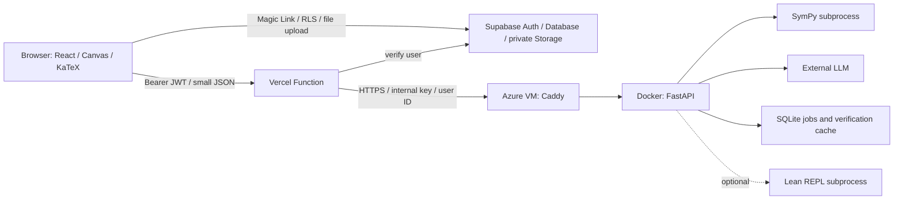

# Math Notebook 統合設計書 v1.9

2026-10-24 · 実装基準版 · 日本語

## 1. 目的と適用範囲

Math Notebookは、手書きの途中式をそのまま認識し、数式処理系（CAS）で前の式との整合を調べ、誤りの根拠と段階的ヒントによって学生自身の書き直しを支援するWebアプリケーションである。検証済みのAI補完、演習プリントの読込、検証状態を保持したLaTeX文書出力を備える。追加機能として、Leanによる高度な数学的命題の形式証明を扱う。

本書に製品要求、Must・Should・Could、インフラとの接続、データ・API契約、状態遷移、検証条件、開発手順を定義する。アプリケーションの実装に別の設計書や既存コードを必要としない。インフラ担当はクラウド資源の構築・設定を担い、アプリ担当は本書の接続契約を実装する。

実装、ソースコード生成、スキーマ生成、マイグレーション作成、テストコード・画像・PDF素材・コンテナイメージの作成、デプロイはHack Dayの開発開始後に行う。事前に行うのは要件定義と設計である。本書の型・JSON・構成図は仕様の記法であり、実装済み成果物や試験実績を示すものではない。

### 1.1 製品原則

| ID | 原則 | 実装上の制約 |
|---|---|---|
| P-01 | 計算の検証と命題の証明を分ける | 行の計算・式変形はCAS、明示された数学的命題の形式証明はLeanが担当する。LLMは認識・生成を担い、判定を行わない。両者の結果は別に管理する |
| P-02 | 書かれた誤りを保持する | 認識で係数・符号・添字・欠落・誤植を補正しない。表示用IRを簡約しない |
| P-03 | 操作の主導権を学生が持つ | 手動確定が標準。AI候補は検証後、明示採用で確定する |
| P-04 | 根拠が前提を満たす | 数の領域、正値・整数・区間の制約、式の定義域を確認する |
| P-05 | 不確実さを明示する | 数値一致だけでokにせず、未検証の祖先を後続行にも表示する |
| P-06 | ヒントに解答を含めない | 欠けた式・係数・項・解そのものをヒントに含めない。誤りが未解決なら補完を止める |
| P-07 | 誤りを修正履歴として残す | 修正は別行に書き、旧行を履歴として保持する。操作自体のUndoは可能 |
| P-08 | 追加機能を独立させる | Should・Couldを無効にしてもMustが実行・検証できる |

### 1.2 非目標

問題の自動解答、誤りの自動修正、問題集との答え合わせ・全体採点、手書き風の整形出力、常設二画面分割、ジェスチャー操作、網羅的なLean形式化、専用ハードウェア、共同編集、リアルタイムの端末間同期、過去行の自由編集、含意と同値のユーザー切替、利用者のLLM APIキー持込を対象としない。学習効果を実証済みとは扱わない。

## 2. 優先度と機能境界

### 2.1 Must

| ID | 要求 | 受け入れ試験 |
|---|---|---|
| M-01 | 単一キャンバス、ペン、ストローク消しゴム、行クリア、手動確定 | MT-01 |
| M-02 | 補正しない手書き認識と、その場でのLaTeX表示 | MT-02 |
| M-03 | 問題カード、プリセット、明示的な前提・未知数 | MT-03 |
| M-04 | CASの四値判定、文脈・確定値・未検証依存 | MT-04〜07 |
| M-05 | 根拠、誤り分類、復帰用ヒント2段階、書き直し | MT-08〜09 |
| M-06 | CAS検証付きの右辺補完・次の一手、採用・却下・保留 | MT-10 |
| M-07 | 筆跡・確定・AI採用・PDF取込・修正の多段Undo / Redo | MT-11 |
| M-08 | 通信障害時の保全、重複防止、古い応答の破棄、模擬表示 | MT-12〜13 |
| M-09 | 演習プリントPDF読込：10MiB・5ページ | MT-14 |
| M-10 | 状態・由来・行順を保持した `.tex` 出力 | MT-15 |
| M-11 | Magic Linkログイン、認証中継、所有者別の手動保存・読込、ジョブ基盤 | IT-01〜08 |

M-11はアプリを提供基盤へ接続するための要件である。独自の会員管理、権限管理画面、パスワード管理機能は作らない。

### 2.2 Should

| ID | 機能 | フラグ | 依存 |
|---|---|---|---|
| S-01 | 常時表示の3段階ヒントボタン | hints | Mustの文脈・復帰パネル・ジョブ |
| S-02 | ヒント／完全補完モード | assist_modes | Mustの補完・履歴 |
| S-03 | 1〜3行の行間補完 | bridge | S-02、MustのCAS |
| S-04 | 再現可能なグラフ描画 | plot | MustのIR・前提・CAS |
| S-05 | 高度な数学的命題のLean形式証明 | lean | 認証・保存・ジョブ、独立した証明課題・命題表現 |
| S-06 | 自動保存・再読み込み復元 | autosave | Mustの保存・読込 |

### 2.3 Could

| ID | 機能 | フラグ | 依存 |
|---|---|---|---|
| C-01 | 書き終わりの自動検出・確定 | auto_submit | Mustの認識・確定・Undo |
| C-02 | 参考書PDFの端末内保存、問題抽出、参考本文 | resources | Mustの問題カード・補完。S-01への接続は任意 |

機能フラグはサーバー設定とフロント設定の積集合とする。初期はすべてOFF。C-01のフラグをONにしても、利用者の自動確定設定は初期OFFとする。Mustから追加機能の実装モジュールをimportしない。無効な機能はUI・API・workerを登録せず、通常のAI行・資料行として保存された内容は表示できるようにする。

フロントのbuild時に、有効な機能だけをimportするregistryを生成する。Must専用buildでは空registryとし、Plotly・pdf.js等の未導入依存をbundlerに解決させない。サーバーも有効な機能のmoduleだけを読み込む。registry生成処理と追加用の依存lockも当日作成する。

## 3. システム構成と責任分界



| 層 | 採用技術・責務 |
|---|---|
| フロント | Vite・React・TypeScript、Canvas Pointer Events、KaTeX、単一ストア |
| 中継 | Vercel Node Function。JWT検証、入力制限、内部ヘッダー設定、Azureへの中継 |
| 認証・保存 | Supabase Auth、Postgresの所有者別snapshot、PDF一時転送用private Storage |
| バックエンド | Python 3.12、FastAPI、Pydantic。初期は1コンテナ・uvicorn 1 worker |
| CAS | SymPy子プロセス。1処理5秒で強制終了、同時2本 |
| AI | サーバー側LLMアダプタ。初期providerは構造化JSON出力に対応するGemini |
| ジョブ | Azureの永続volume上のSQLite。受付後はブラウザやVercelの生存に依存しない |
| PDF | ブラウザ転送、サーバーのpypdf検査・pypdfium2レンダリング |
| 追加描画 | Plotly.js basic、pdf.jsを必要時だけ読み込む |
| 形式証明 | Lean 4・Mathlib・REPL。証明課題を独立に処理し、toolchainとMathlib commitを固定 |

インフラ担当はVercelプロジェクト、Supabase、Azure VM、DNS/TLS、NSG、Docker/Caddy、volume、秘密設定を用意する。アプリ担当はgateway、認証画面、API、データモデル、DB/RLSのマイグレーション、worker、Dockerfile、接続試験を作る。資源構築と設定も開発開始後の作業として計画する。

ブラウザから計算APIへは同一オリジンの `/api/v1/*` だけを使う。Supabaseへの直接アクセスはAuthとRLSで保護したDB・Storageに限る。Caddyが443で受信し、ホストの `127.0.0.1:8000` へ転送する。コンテナ内FastAPIは `0.0.0.0:8000`。ホストの8000番は外部公開しない。

## 4. 認証・保存・ファイル転送

### 4.1 Magic Link

ログイン画面はメールアドレス、リンク送信、送信結果、再送のみ。Supabaseの既存利用者を対象とし、公開signupを停止する。`signInWithOtp` に `shouldCreateUser:false` と許可済みの `emailRedirectTo=<origin>/auth/callback` を指定する。送信成功だけではログイン済みにしない。[Supabase passwordless email](https://supabase.com/docs/guides/auth/auth-email-passwordless)

SPAはSupabase SDKの標準implicit flowとURLセッション検出を使い、callbackでSDKがセッションを確立するのを待つ。独自のコード交換処理やPKCE用callbackを混在させない。取得後はURLの認証情報を除去し、ノートへ移動する。リンク期限切れ・使用済み・メール未着は再送を案内する。受信メールとタブレットでの遷移、SMTP、送信制限、Site URL・redirect allowlistを当日確認する。

ブラウザはaccess tokenをBearerとしてgatewayへ送る。gatewayは要求ごとにSupabase `getUser(token)` で検証し、返ったuser.idを利用者IDにする。ブラウザの自己申告IDやサーバー上の `getSession()` の値だけで認可しない。セッションの保持・更新はSDKへ任せる。[Supabase getUser](https://supabase.com/docs/reference/javascript/auth-getuser)

ブラウザのSupabase clientはアプリ内で一つに統一する。Functionのclientは要求ごとに生成し、利用者セッションを永続化・グローバル共有しない。callback処理とSDKの自動検出で同じ認証応答を二重処理しない。

ログアウト時は未保存変更を確認し、利用者別のメモリと端末保存を消す。期限切れでは筆跡を消さず再認証を求め、同じ利用者の復帰後に再試行する。別利用者に切り替わった場合は前利用者のノートを表示しない。

### 4.2 gatewayと内部認証

gatewayはmethod・経路のallowlist、JSON上限2MiB、JWTを検査する。ブラウザの `X-API-Key`、`X-User-Id`、内部URLは破棄し、検証済みuser.idとサーバーのBACKEND_API_KEYで作り直す。AzureはAPIキーをconstant-timeで照合し、job・検証cacheをownerで分離する。

固定BACKEND_URLのHTTPSだけへ転送する。外部から任意URLを渡せる中継を作らない。通常要求のアプリdeadlineは9秒、Vercel Functionは10秒以上を確保する。同期CASはHTTP全体6秒以内、ジョブ受付・照会は原則1秒以内。応答は `Cache-Control: private, no-store`。認証結果や計算結果をCDNに保存しない。

APP_ENV=localの開発環境だけは、固定したloopback HTTP originをBACKEND_URLに許可する。本番ではHTTPSを必須とし、この例外を有効にしない。

`/api/v1/*` は単一 `api/gateway.ts` へrewriteし、SPA fallbackより先に評価する。`/auth/callback` はSPAへ到達させる。APIの404がindex.htmlの200に化けないこと、gatewayへ直接アクセスしても同じ検査が働くことを試験する。任意のCORS公開やブラウザへの内部キー埋込は行わない。

### 4.3 ノート保存

Supabase DBに次の1テーブルを置く。利用者の追加はSupabase Authの運用で行い、アプリ独自の会員テーブルは設けない。

| mn_notebooks列 | 型・制約 |
|---|---|
| id | UUID、primary key、snapshot.idと一致 |
| owner_id | UUID、auth.usersへの参照、作成後変更不可 |
| title | text、1〜200文字 |
| schema_version | text、`1.9.0` |
| revision | bigint、初回1、更新ごとに1増加 |
| snapshot | JSONB、object、schema_version一致、DB上のtext表現8MiB以下 |
| updated_at | timestamptz、DBが設定 |

RLSを有効にし、authenticatedのSELECT・INSERT・UPDATE・DELETEを `owner_id=auth.uid()` に限定する。INSERT・UPDATEには同じWITH CHECKを付け、anon権限は与えない。ID・ownerの変更をトリガーで拒否する。owner_idとupdated_atの複合indexを作る。[Supabase RLS](https://supabase.com/docs/guides/database/postgres/row-level-security)

本人のJWTとpublishable keyで直接保存する。更新はid・owner・expected revisionを条件にし、返却0件は競合。「読み直す／別ノートとして保存／戻る」を出し、黙って上書きしない。snapshotには候補、進行中job、履歴スタック、JWT、秘密鍵、署名付きURLを含めない。

### 4.4 演習プリントの転送

Vercel Functionの要求・応答上限4.5MBを避けるため、PDF本体をbase64でgatewayへ送らない。ブラウザからprivate Storage bucket `mn-imports` へ転送し、APIには参照だけを渡す。[Vercel Function limits](https://vercel.com/docs/functions/limitations)

pathは `<user_uuid>/<notebook_uuid>/<import_uuid>/source.pdf`、最大10MiB、MIMEはapplication/pdf、upsertはfalse。Storage RLSはbucket一致とpath先頭のuser UUIDがauth.uid()と一致することをINSERT・SELECT・DELETEに要求する。UPDATEは許可しない。6MiB超はTUS再開可能uploadを使う。[Supabase Storage access control](https://supabase.com/docs/guides/storage/security/access-control)、[resumable uploads](https://supabase.com/docs/guides/storage/uploads/resumable-uploads)

gatewayは本人のpathとnotebook IDを検査し、本人JWTで600秒の読取URLを発行して内部要求に付ける。Azureは設定したSupabase origin・署名読取pathだけから取得し、redirectを追わず、bytes・SHA-256・timeoutを検査する。service roleキーはブラウザ・Azureへ配布しない。

終了後はブラウザがStorage objectを削除する。中断等で残った24時間超のobjectはインフラ担当の管理runnerがStorage APIで回収する。処理中の一時ファイルはAzureの専用tmpdirへ置き、finallyで削除する。URL期限切れはSOURCE_EXPIREDとして本人に再試行を求める。

## 5. 共通データモデル

wire・保存形式はsnake_case、schema_versionは `1.9.0`。UUIDをnotebook・request・job・verification・candidate・client sessionに使う。line・stroke・problemのIDは英数字と `_ -` の1〜64文字。次の型は契約表記であり、実装ではTypeScriptとPydanticで同じ制約を強制する。

```ts
type Id = string;
type Hash = string; // sha256: + 64 lowercase hex
type MathJSON = string | number | null | [string, ...MathJSON[]];
type Status = 'ok' | 'wrong' | 'unknown' | 'none';
type Method = 'sym' | 'sets' | 'solve' | 'eval' | 'cx' | 'num' | 'def';
type Role = 'premise' | 'definition' | 'step' | 'text';
type Source = 'user' | 'ai' | 'pdf' | 'resource';
type SuggestMode = 'COMPLETE_RHS' | 'NEXT_STEP' | 'BRIDGE';
type Feature = 'hints' | 'assist_modes' | 'bridge' | 'plot' | 'lean'
  | 'autosave' | 'auto_submit' | 'resources';
type Segment =
  | {type:'text'; text:string}
  | {type:'math'; expr:MathJSON; notation:'plain'|'continuation'; latex:string};
type InputSegment =
  | {type:'text'; text:string}
  | {type:'math'; expr:MathJSON; notation:'plain'|'continuation'};
interface Stroke {
  id: Id; points: {x:number; y:number; t:number; p:number}[];
}
interface Assumption {
  symbol:string;
  kind:'real'|'positive'|'nonnegative'|'nonzero'|'positive_integer'|'interval';
  lower?:MathJSON; upper?:MathJSON; source:'user'|'adopted';
}
interface Problem {
  id:Id; title:string; statement:Segment[];
  definitions:MathJSON[]; conditions:MathJSON[];
  assumptions:Assumption[]; unknowns:string[]; independent_var?:string;
  origin?:{kind:'preset'|'pdf'|'resource'; name:string; page?:number};
}
interface Evidence {
  kind:'COUNTEREXAMPLE'|'SOLUTION_DIFF'|'DOMAIN_CONDITION'|'EXACT_MISMATCH';
  assignment?:Record<string,string>;
  context_value?:string; written_value?:string;
  missing?:string[]; extra?:string[]; condition_latex?:string;
  approx?:boolean; summary:string;
}
interface SegmentProof {
  segment_index:number; status:Status; goal?:string; method?:Method;
  reason?:string; category?:string; conditions:string[]; evidence:Evidence[];
}
interface Proof {
  status:Status; goal?:string; method?:Method; reason?:string; category?:string;
  conditions:string[]; evidence:Evidence[];
  hints:{level:1|2; text:string; refs:Id[]}[];
  segment_results:SegmentProof[];
  depends_on:Id[]; depends_on_unverified:boolean; unverified_ancestors:Id[];
  input_hash:Hash; mock:boolean;
  cas:{version:string; rules_version:'1.9.0'; elapsed_ms:number; timed_out:boolean};
}
interface Verified {verification_id:Id; input_hash:Hash; proof:Proof}
type FormalExpr = string | number | [string, ...FormalExpr[]];
interface LeanTask {
  id:Id; version:number; statement_text:string;
  variables:{id:Id; name:string; type:'Nat'|'Int'|'Real'}[];
  assumptions:{id:Id; proposition:FormalExpr}[];
  conclusion:FormalExpr;
  source_refs:{line_id:Id; version:number; adopted_as_assumption:boolean}[];
}
interface LeanPrepared {
  prepared_id:Id; task:LeanTask; statement:string; statement_hash:Hash;
  unresolved_symbols:string[];
}
interface LeanResult {
  task_id:Id; task_version:number; statement_hash:Hash;
  state:'proved'|'unproved'|'timeout'|'skipped'|'unavailable';
  statement:string; proof?:string; attempts:number; log?:string; reason?:string;
}
interface Line {
  id:Id; version:number; source:Source; role:Role;
  state:'DRAFT'|'RECOGNIZING'|'RECOGNIZE_FAILED'|'VERIFYING'|'SETTLED'|'SUPERSEDED';
  ink:Stroke[]; segments:Segment[]; parent_id?:Id; verified?:Verified;
  failure?:{stage:'recognize'|'verify'; code:string};
  revision_of?:Id; recovery_root_id?:Id; superseded_by?:Id;
  ai_origin?:{candidate_id:Id; mode:SuggestMode};
  document_origin?:{name:string; page:number; has_unreadable:boolean};
  extensions?:Record<string,unknown>;
}
interface Recovery {
  root_line_id:Id; current_line_id:Id;
  phase:'WRONG_SHOWN'|'EVIDENCE_OPEN'|'HINT_FOCUS'|'HINT_LOCATE'
    |'REVISING'|'REVERIFYING'|'RECOVERED'|'UNRESOLVED';
  opened_at:Partial<Record<'evidence'|'hint1'|'hint2'|'revise'|'recovered',number>>;
}
interface Notebook {
  schema_version:'1.9.0'; id:Id; title:string; mode:'live'|'mock';
  domain:'Reals'; problem:Problem; lines:Line[]; recoveries:Recovery[];
  extensions?:Record<string,unknown>;
}
interface Meta {
  request_id:Id; notebook_id:Id; client_session_id:Id; client_epoch:number;
  line_id?:Id; line_version?:number; context_fingerprint:Hash;
}
interface Target {
  id:Id; role:Role; segments:InputSegment[];
  revision_of?:Id; recovery_root_id?:Id;
}
interface Context {
  problem:Problem; domain:'Reals'; mode:'live'|'mock'; parent_line_id?:Id;
  lines:(Target & {verification_id:Id; input_hash:Hash})[];
}
interface CandidateLine {target:Target; segments:Segment[]; verified:Verified}
interface CandidateResult {
  state:'READY'|'NONE'; reason?:string;
  candidate?:{id:Id; mode:SuggestMode; content_hash:Hash; lines:CandidateLine[]};
}
interface Job<T = unknown> {
  id:Id; kind:string; state:'queued'|'running'|'succeeded'|'failed'|'cancelled'|'expired';
  phase:string; meta:Meta; created_at:string; expires_at:string;
  result?:T; error?:{code:string; message:string; retryable:boolean};
}
type ApiResponse<T> =
  | {ok:true; request_id:Id; data:T}
  | {ok:false; request_id:Id; error:{code:string; message:string;
      retryable:boolean; retry_after_ms?:number}};
```

保存されたProofは表示用の「保存時の結果」である。新しい検証や補完で前提に使う際は、Azureがverification_idを所有者別cacheから読み、内容・input_hashを照合する。クライアントが送るstatusを数学的事実として信用しない。cacheは24時間保持し、期限切れは上からCAS再検証する。認識の再実行は不要。

Proof・VerifiedはCASの検証報告である。LeanTask・LeanResultは別のデータであり、CASのverification_idを必要としない。証明課題・形式化確認済み命題・証明結果はNotebook.extensions.lean_tasksへ保存し、進行中のjob IDはsnapshotに含めない。

### 5.1 上限と拡張

| 対象 | 上限 |
|---|---|
| API JSON・応答 | UTF-8で2MiB |
| 認識画像 | 実体1MiB、長辺1000px、PNG/JPEG |
| IR | 256ノード、深さ24、整数絶対値10¹²、整数指数絶対値100 |
| 1行 | 16 segments、数式8個、文章4000字、筆跡20,000点 |
| 文脈 | 有効な数学64行、条件・定義各16、仮定32、未知数3 |
| snapshot | 8MiB。DB表現の上限も確認し、超過時は内容を保持して保存失敗を表示 |
| 参考本文 | 合計9000 Unicode文字 |

数式の小数は厳密なDivideで表し、NaN・Infinityの数値を禁止する。グラフと筆跡だけ有限の小数を許す。LLM出力の未知fieldは拒否する。snapshotのextensionsだけは未知キーを保持でき、未知機能を実行しない。

## 6. 数式IRと変換

数式の唯一の内容表現は非正規化MathJSONのexprである。項の順序、符号、括弧、欠落を保存する。文字列の記号名は `[A-Za-z][A-Za-z0-9_]{0,31}`。IRで計算を簡約しない。

| 演算子 | 引数・意味 |
|---|---|
| Add、Multiply | 式2〜16個 |
| Subtract、Divide | 式2個 |
| Negate、Sqrt、Abs、Sin、Cos、Tan、Exp、Ln | 式1個 |
| Power | 底と整数指数。非整数指数はUNSUPPORTED |
| Equal | 左辺、右辺。空の右辺だけnullを許す |
| EqualChain | 式3〜8個。表示保持、意味検証はUNSUPPORTED |
| Less、LessEqual、Greater、GreaterEqual、NotEqual | 式2個 |
| And、Or | 関係式2〜16個 |
| PlusMinus、Set | 中心と幅／集合要素0〜16個 |
| D | 式、微分変数。高階は入れ子 |
| Prime | 関数名、引数記号。定義済み関数の1階微分 |
| Apply | 関数名、引数の式 |
| Integrate | 被積分式、`[Tuple,変数,下限,上限]` |
| Evaluate | 評価する式、`[Tuple,変数,下限,上限]`。上端値から下端値を引く |
| Sum | 式、Tuple。保存・表示、Mustの検証はUNSUPPORTED |
| Limit | 式、`[LimitSpec,変数,値,"both"または"left"または"right"]`。保存・表示のみ |
| Unreadable | 引数なし。表示は□ |
| 定数 | Pi、ExponentialE、ImaginaryUnit、Hbar。Infinityは端点・極限値専用 |

Tuple・LimitSpecは専用位置だけで使い、単独の数式にしない。記号と定数を区別し、不正な演算子を任意の関数呼出へ変換しない。数式rootのnull、空の左辺、不正引数、上限超過はIR_INVALID。認識時は筆跡を残して失敗、既存の有効IRでも意味処理が未対応ならunknownにする。

continuationは `notation=continuation` と右側のexprで表す。`=x²+x` はexpr `[Add,[Power,x,2],x]`。serializerが先頭 `=` を付ける。空右辺の `I(a)=` は `[Equal,[Apply,I,a],null]`、判定は必ずunknown / INCOMPLETE。

行のIRからLaTeX・SymPyへ個別に変換する。LaTeXはサーバーが生成し、保存読込時も同じ規則のフロントprinterで再生成する。両言語の固定入力に対する出力一致を試験する。表示LaTeXをCAS入力へ再解析しない。SymPyは演算子対応表で組み立て、任意文字列のeval、sympify、parse_exprを使わない。Leanは第14.4節の型付き命題表現を使い、行のIRは必要な部分をその入力へ取り込む。

EvaluateのLaTeXは `\left[F(x)\right]_{l}^{u}`、SymPy変換は保存したFへ上端と下端を代入して差を取る。IR自体のFを簡約結果へ置き換えない。

Integrate・Evaluate・Sumの束縛変数は自由記号や未知数の推定から除外する。関数定義の引数代入では変数捕捉を避け、束縛変数へ外側のbindingを適用しない。各式の自由変数と束縛変数をvisitorで区別する。

## 7. API・ジョブ・非同期制御

### 7.1 通信形式

ベースパスは `/api/v1`。認証が必要。POSTは `{meta:Meta,input:入力}`、Idempotency-KeyヘッダーにUUIDを付ける。応答はApiResponse。ジョブ受付は202で `{job:Job}`、同期処理は200で `{meta,...結果}`。数学的wrongはAPIの成功結果であり、HTTPエラーではない。

| HTTP・経路 | input | 結果 |
|---|---|---|
| GET /capabilities | なし | schema_version、build_id、全featureのboolean、CAS/LLM/Lean状態 |
| GET /health | なし | status、build_id、CAS起動可否、LLM設定有無、Lean ready。秘密は含めない |
| POST /recognize | image、previous_math_latex?、ui_lang、prefetch | job → `{segments,unreadable,mock}` |
| POST /verify | context:Context、target:Target | `{meta,verified:Verified}` |
| POST /suggest | context、mode、based_on_line_id、target_line_id、lhs_expr?、bridge_to?、rejected_hashes、reference? | job → CandidateResult |
| POST /pdf/imports | object_path、file_name、bytes、sha256、ui_lang | job → `{pages:[{page,lines:[{segments,has_unreadable}]}],mock}` |
| GET /jobs/{id} | なし | `{job}`。owner一致が必要 |
| DELETE /jobs/{id} | なし | `{job}`。待機・実行中をcancelし、終端状態ならそのまま返す |
| POST /hints | context、after_line_id、level、ui_lang、reference? | S-01 job → hint |
| POST /plot | context、target、settings | S-04同期 → plot |
| POST /lean/prepare | taskの記述、既知の変数・仮定・結論、source_refs | S-05 job → LeanPrepared。形式化の確認用 |
| POST /lean/jobs | prepared_id、confirmed_statement_hash | S-05 job → LeanResult。確認した命題の証明 |
| POST /resources/page | page、image、ui_lang | C-02 job → ページsegments |
| POST /resources/problems | page、page_text、ui_lang | C-02 job → problems |

verifyのcontext.linesは対象より前の有効な行のみ。修正では修正元を除き、その元の親までを使う。suggestは全有効行を送り、サーバーが誤りロックを確認した後、based_on_line_idまでのprefixを数学的文脈にする。右辺補完は不完全行の直前までを使う。meta.line_idは操作元の行、NEXT_STEPのtarget_line_idは予約した新規行ID。候補のverificationは採用先IDで発行する。

### 7.2 ジョブの実行

SQLiteへowner、kind、idempotency key、入力digest、payload、state、phase、時刻、結果・エラーを保存してから202を返す。unique(owner,kind,key)。同じkey・同じ入力は同じjobを返し、異なる入力なら409。期限付き転送URLやrequest_idは入力一致判定から除く。同期verifyも同じ入力の完了応答を再利用できる。

応答を受け取れなかった要求の再送には同じkeyを使う。終端のfailed／cancelled／expiredを確認した後、本人が処理をやり直す場合は新しいkeyを発行する。削除済みのPDF sourceは再転送し、有効な読取URLを発行し直す。

```text
queued -> running -> succeeded / failed
queued / running -> cancelled
queued -> expired
```

queuedの上限30秒。実行上限は認識45秒、補完60秒、PDF180秒、hint15秒、Lean形式化45秒・証明90秒、参考書ページ／問題45秒。実行timeoutはfailedとし、Lean証明は可能ならtimeout結果で正常終了する。成功結果は1時間、再送防止用keyは24時間保持。結果期限切れは410。勝手に新しい有料jobを作らない。

FastAPI lifespanでdispatcherを1つ起動する。uvicornは1 worker、SQLite WAL。claimはtransaction内の条件付き更新。LLM同時2、CAS同時2、Lean同時1、利用者あたり未終了4、全体待機32を上限とする。認識を背景処理より優先する。枠超過は429。

再起動時のrunning jobはWORKER_RESTARTEDで失敗とし、外部処理を自動再実行しない。queuedは期限内だけ再開する。cancelはDB状態を更新し、子プロセスを終了、外部LLMはbest effortで中断する。workerは結果書込前にもcancelを確認し、取消後に成功へ戻さない。

ポーリングは最初1秒、10秒後2秒、30秒後5秒。終端で停止する。認証更新後も同じIDを照会する。ジョブのkindとresult schemaを必ず対応させる。

Job.metaは作成時の値を保持し、poll応答の外側のrequest_idで置き換えない。非同期結果のactive slotとの照合にはJob.metaを使う。

### 7.3 応答照合とcache

認識・CAS・補完等の行に属する処理は、request_id、notebook_id、client_session_id、client_epoch、line_id、line_version、context_fingerprintがactive request slotと一致した結果だけを反映する。下読みはstroke hashも照合する。Undo、新行確定、修正開始、問題・モード変更、ノート切替でepochを増やし、関連要求をabort、既知jobをcancelする。旧応答をUIにも履歴cacheにも適用しない。独立したLean課題の結果照合は第14.4節に従う。

数学的cacheと通信指紋を分ける。canonical JSONはキー辞書順、配列順序保持、不要空白なし、UTF-8、整数の十進表記、Unicode保持。数学payloadは小数を含めない。

- semantic hash：notebook ID、問題の数学的内容、領域、live/mock、有効祖先のID・role・expr・notation・修正関係・数学的判定digest。
- input_hash：rules/CAS版、semantic hash、対象ID・role・expr・notation・修正関係、親ID。
- context_fingerprint：semantic hash、session ID、epoch、行version。
- candidate hash：modeと候補IR・notation。却下履歴は文脈ごとに分ける。

数学的digestからelapsed_ms、UI開閉、筆跡、通信versionを除く。検証cacheはowner・input_hashで検索し、過去の検証結果はその行の直前のprefixで照合する。Undo / Redoで世代を進めても同じ内容の結果を使える。cache不在・文脈変更時はCONTEXT_REVERIFY_REQUIREDとし、最初の無効行から順に再検証する。

### 7.4 エラー

| HTTP | code | 利用者への動作 |
|---|---|---|
| 400 | INVALID_REQUEST、IR_INVALID、IMAGE_INVALID、PDF_CORRUPTED_OR_ENCRYPTED | 入力の修正。内容を保持 |
| 401 | AUTH_REQUIRED、TOKEN_INVALID | SDK更新1回、その後Magic Link再認証 |
| 403 | FEATURE_DISABLED、BACKEND_KEY_INVALID | 機能または設定の問題を表示 |
| 404 / 410 | NOT_FOUND / JOB_EXPIRED | 他人のjobは404、期限切れは再試行を案内 |
| 409 | IDEMPOTENCY_CONFLICT、CONTEXT_REVERIFY_REQUIRED、UNRESOLVED_WRONG、LINE_IS_WRONG、SUGGEST_NOT_AVAILABLE | 操作・文脈を更新 |
| 413 | PAYLOAD_TOO_LARGE、PDF_TOO_LARGE、PDF_PAGE_LIMIT_EXCEEDED、RESULT_TOO_LARGE | 上限を表示 |
| 422 | ASSUMPTIONS_INVALID、SNAPSHOT_INVALID | 前提・保存形式を修正 |
| 429 | RATE_LIMITED、QUEUE_FULL、CAS_BUSY | retry_after_msに従う |
| 502 / 503 / 504 | UPSTREAM_INVALID、BACKEND_UNAVAILABLE、CAS_UNAVAILABLE、LEAN_UNAVAILABLE、GATEWAY_TIMEOUT | 依存先の失敗を表示し同じkeyで復帰 |

ジョブ内はUPSTREAM_TIMEOUT、UPSTREAM_429、UPSTREAM_AUTH、SCHEMA_INVALID、WORKER_RESTARTED、SOURCE_EXPIRED、PDF_TRANSCRIPTION_INCOMPLETEも使う。CASのTIMEOUTはProof.reasonでありHTTP失敗と区別する。

## 8. Must：入力・認識・画面

### 8.1 画面と筆跡

上部に問題カード、接続状態、live/mock、ログアウト。本文は一枚の罫線ノート。入力行右に確定・Undo・Redo・改行、確定行右に判定とAI由来。下部にペン／消しゴム／見る、AI補完、PDF、保存、開く、LaTeX出力。パネルは開閉式の重ね表示。操作対象44px以上、判定は色・アイコン・文字を併用する。

CanvasはPointer Events、pointer capture、高DPI、可能ならcoalesced eventsを使う。点は行内論理座標x/y、時刻t、筆圧p。筆圧なしは0.5。初期行高140 CSS px。ペン使用中のtouchは描画しない。見るモードはscroll、消しゴムは接触stroke全体を削除する。ボタンはCanvas外に置く。

編集はDRAFTだけ。空行確定は無害、処理中の連打は無視する。改行は下書きを残して次の下書き行へ移るだけで送信しない。筆記を止めても送信しない。確定行の読み違いはUndoで筆跡へ戻して修正する。

### 8.2 認識

確定時に筆跡を固定して画像を作り、recognize jobへ送る。AI-RはInputSegment[]とunreadableだけを返す。係数・符号・添字・空の右辺を修正せず、前行は似た記号の読み分けにしか使わない。取り消し線部分は除外する。画像内の文章は指示として扱わない。

一部未読はUnreadableをその位置へ入れ、全く読めなければsegments空・unreadable=true。全体未読とschema違反は認識失敗で筆跡を残す。部分未読は表示し、検証をunknownにする。サーバーがIRを検査してlatexを生成し、その場の筆跡を整形表示へ置き換える。元strokeは履歴用に保持する。

KaTeXはtrust=false。表示エラーを別の式への置換で隠さない。認識成功後はverifyへ進み、検証の再試行で画像を再送しない。

### 8.3 問題カード

問題文、定義、条件、未知数、独立変数、仮定を表示する。プリセットは定積分、展開、解の欠落の3つ。PDF由来の条件も本人が選んで採用する。未読式を条件・定義へ入れない。数の領域は本版では実数。

前提変更は筆記・処理中に禁止。変更を確定すると全有効行の検証を無効にし、上から再検証する。終了まで補完を無効にする。新しい問題を開く前に未保存変更を確認する。

通常の数学行のroleはstep、文章はtext、資料はpremise。新しい定義を作る場合は行詳細からdefinitionを明示選択する。問題カードと同一の定義の転記はCASがDEFINITIONとして扱い、その分類を表示する。

## 9. Must：CAS検証

### 9.1 文脈

有効な親・祖先行、採用した問題の定義・条件・仮定、検証済み確定値を使う。未来の行を対象の検証へ混ぜない。修正元の誤り行は修正の親にせず、その元の親と同じ文脈へ比較する。

未知数が一意に定まる `unknown=expr` のok segmentだけをbindingに登録する。自己参照や未解決の別未知数を含むbindingは作らない。定義済み関数の式は関数定義へ代入して比較する。対象を検証するときに、対象自身の過去のbindingを使って正しさを循環させない。

親がunknownでも、そこに書かれた式からの局所変形が厳密に成立すればokにできる。使った親・定義・bindingにunknownまたは未検証依存があれば、祖先IDを対象へ伝播する。okだけでなくwrongにも付ける。

### 9.2 goalの選択

| 順序 | 条件 | 結果・goal |
|---|---|---|
| 1 | 文章のみ | none / TEXT_ONLY |
| 2 | 問題前提・資料参照 | none / PREMISE、未読は前提にしない |
| 3 | 未読・未完成・空右辺 | unknown / UNREADABLEまたはINCOMPLETE |
| 4 | 新しい明示定義、問題定義の同一転記 | none / DEFINITION。異なる再定義はUNSUPPORTED |
| 5 | 比較対象がない最初の式 | none / NO_PARENT |
| 6 | continuation | EXPRESSION_EQUIVALENCE |
| 7 | 定義済み関数・記号・微分の値 | EQUATION_FROM_CONTEXT |
| 8 | 線形連立And | SYSTEM_SOLUTION。未知数3まで |
| 9 | 親・対象が関係式 | SOLUTION_SET_EQUIVALENCE |
| 10 | 厳密な定数比較 | CONSTANT_EVALUATION |
| 11 | その他 | unknown / UNSUPPORTED |

未知数は問題宣言を優先し、未宣言なら独立変数と仮定付きパラメータを自由記号から除く。曖昧ならAMBIGUOUS_UNKNOWNS。積分・Evaluateはgoal内部で評価する。

### 9.3 判定規則と実行制限

okは、仮定下で差が記号的に0、解集合が一致、または厳密な定数値が一致し、定義域も変わらない場合に限る。wrongは前提内の反例、具体的な解集合の差、厳密な定数不一致がある場合に限る。簡約が0にならないことだけではwrongにしない。数値一致だけならNUM_ONLY、反例も一致も確かめられなければNO_EVIDENCE。

方程式は解集合の同値を調べる。`x²=4 → x=2` は欠落、逆方向は余分な解。実数で双方が空集合なら同じ解集合だが、複素数での結果とは扱わない。含意の証明とは意味を分ける。

簡約前のIRから分母・根号・対数等の定義域を保存する。`(x²-1)/(x-1) → x+1` はunknown / DOMAIN_CHANGED、条件x≠1。本人が前提を変更して再検証するまで無条件のokにしない。互いに矛盾する仮定はASSUMPTIONS_INVALID。

1回のCASはgoal・根拠・分類まで含めて5秒で子プロセスを強制終了する。timeoutはunknown / TIMEOUT、worker異常はunknown / CAS_ERROR。同時2本、枠が満杯なら待たせず429。重い計算をASGIイベントループ上で実行しない。

微分、有限区間の定積分、Evaluate、代数を対応範囲とする。不定積分の定数族、一般ODE/PDE、無限和はUNSUPPORTED。対応する演算子であっても5秒内に検証できなければunknownにする。

### 9.4 反例・分類・複数数式

反例候補は0、1、-1、2、-2、3、1/2、-1/2、1/3の順。パラメータを先に決め、区間変数は端点と単純な内部点を使う。正値・整数・区間・全関連式の定義域を確認する。一致点で止めず、200通りまたは1秒で打ち切る。厳密値を優先し、近似不一致は精度増加でも差が安定して評価誤差を超えると確認できる場合だけapprox=trueで使う。

分類はCASだけで行う。解集合差はMISSING_SOLUTION／EXTRA_SOLUTION。関数比-1はSIGN、独立変数に依存しない±1以外の比はCOEFFICIENT、非零の定数差はCONSTANT_TERM。積分からEvaluateへの誤りで、原始関数候補の微分と被積分式に項の差があり、元の定積分値とEvaluate値も異なると確認できた場合はINTEGRATION_TERM。定義域はDOMAIN、残りはUNCLASSIFIED。

1行の複数数式は同じ入力文脈で独立検証し、segment_resultsへ保存する。行内の前の式を勝手に次の式の前提にしない。行全体はwrong優先、次にunknown、次にok、全部noneならnone。詳細には各結果を表示し、ok segmentだけがbinding候補になる。定義行は数式1個に限定する。

## 10. Must：誤りからの復帰

wrong直後は種類だけを表示する。「根拠を見る」はEvidenceを開き、「ヒント1」は観点、「ヒント2」は位置を開く。根拠はCASの数値・解集合差をテンプレート化し、LLMに事実を作らせない。

| 分類 | ヒント1 | ヒント2 |
|---|---|---|
| INTEGRATION_TERM | 被積分関数の各項に、積分後も対応する項があるか確認しましょう。 | 問題の被積分関数の各項と、この行の角括弧の中を対応させましょう。 |
| COEFFICIENT | 式全体にかかる定数倍を確認しましょう。 | 行{binding}で求めた記号が定義のどこへ入るか確認しましょう。 |
| SIGN | 符号を確認しましょう。 | 親行からの微分・移項・展開で符号が変わる箇所を追いましょう。 |
| CONSTANT_TERM | 変数を含まない定数項を確認しましょう。 | 親行の定数部分とこの行を対応させましょう。 |
| MISSING_SOLUTION | 前の行を満たす値がすべて残っているか確認しましょう。 | 平方根を取る・割る操作で解が減っていないか見直しましょう。 |
| EXTRA_SOLUTION | この行の解が前の行も満たすか確認しましょう。 | 2乗する・掛ける操作で解が増えていないか見直しましょう。 |
| UNCLASSIFIED | 変形を一段階ずつ確認しましょう。 | 2行に分けて書くと比較しやすくなります。 |

埋め込めるslotは既出の記号と行番号のみ。欠けた係数・項・解の文字列表現、および対象行の代わりに置くとCASでokになる数式断片をヒントへ含めない。テンプレート全体を漏えい試験する。復帰用ヒントの自由なLLM言い換えは作らない。

どの段階でも「書き直す」で直下にDRAFTを作る。revision_ofとrecovery_root_idを設定し、同じ親に対して再検証する。修正確定で旧行は比較対象から外し、履歴として残す。修正okだけがRECOVERED、unknownはUNRESOLVED、wrongは新しい根拠で再開する。未解決グループが一つでもあれば全AI補完を止める。

表示はok・祖先なし「✓ 検証済み」、祖先あり「✓ 局所変形は整合（未検証：行N）」、wrong「✗ 不一致・種類」、unknown「? 未検証・理由」、none「─ 前提／定義／文章」。認識・通信失敗は数学的誤りと表示しない。

## 11. Must：AI補完

`COMPLETE_RHS` は空右辺行の左辺を構造一致で固定し、完成式を直前の有効行と問題文脈へ比較する。`NEXT_STEP` は最後の確定ok／none、またはTIMEOUT・NO_EVIDENCE・NUM_ONLY・UNSUPPORTEDのunknownから小さい一手を求める。unknownからの局所変形は祖先を継承する。未読・未完成・再検証待ち・未解決修正からは起動しない。

問題カード、直近8有効行、モード、左辺、却下hashをLLMへ渡す。1行のInputSegment[]またはnullを受ける。数式なし、左辺変更、不正IR、同一IR・notationの既存行／却下候補は捨てる。「CASで同値だから重複」とは扱わない。式変形は同値であること自体が目的だからである。

サーバーは候補をCASで事前検証し、okだけをREADYとして返す。unknown／wrongは表示・採用不可。未解決wrong、または修正関係を持つunknown行が文脈にあれば、LLMを呼ばず409 UNRESOLVED_WRONG。文脈の全行とserver cacheを照合する。

候補は破線とAI由来・未採用・検証状態を表示する。筆記中に届いたらHELDで表示を保留し、止まれば同じ文脈に限りREADYへ戻す。他行確定・Undo・文脈変更ではSTALE。採用は二重実行不可。NEXT_STEPは新規行、COMPLETE_RHSは対象の右辺を埋め、どちらもAI由来と元の筆跡を保持する。却下で確定行は変えず、同じ文脈で同一候補を再表示しない。

## 12. Must：状態・履歴・入出力

### 12.1 状態遷移

```text
Line:
DRAFT -> RECOGNIZING -> VERIFYING -> SETTLED
RECOGNIZING -> RECOGNIZE_FAILED -> retry / DRAFT
SETTLED -> VERIFYING (recheck)
original wrong line -> SUPERSEDED (revision confirmed)

Recovery:
WRONG_SHOWN -> EVIDENCE_OPEN -> HINT_FOCUS -> HINT_LOCATE
any stage -> REVISING -> REVERIFYING -> RECOVERED / UNRESOLVED / WRONG_SHOWN

Candidate:
GENERATING -> READY / NONE; READY <-> HELD
READY -> ADOPTED / REJECTED; pending states -> STALE on context change
```

HTTP失敗で検証結果を得られないときはfailure.stage=verifyと再検証ボタンを出す。CAS時間切れはSETTLEDのunknown。すべての処理は成功・失敗・時間切れ・取消のいずれかへ着地させる。

### 12.2 Undo / Redo

Commandはserializableなbefore/after差分、対象ID、完了済みsegments・Verifiedを持つ。実行関数をDBへ保存しない。past/futureでADD_STROKE、ERASE_STROKES、CLEAR_DRAFT、ADD_DRAFT、CONFIRM_LINE、START_REVISION、ADOPT_CANDIDATE、REJECT_CANDIDATE、IMPORT_PDF、EDIT_PROBLEMを扱う。

確定開始時にcommandを積み、activeなまま結果が届いた場合だけafterを更新する。待機中Undoは要求・jobを取り消し、遅延結果を破棄する。完了済みRedoは再送0で復元する。未完了commandのRedoは下書きと再試行可能状態へ戻し、自動でAPIを再実行しない。新しい内容変更でfutureを消し、空スタック操作は無害とする。

内容は戻してもepochと行versionは単調増加させる。数学的cacheを別hashで照合する。保存・出力・根拠開閉は履歴に積まない。

### 12.3 PDF取込

サイズ・SHA-256を確認して第4章の経路で転送する。Azureはpypdfで10MiB・5ページ・破損・暗号化を検査し、1ページずつ長辺1000px以内へレンダリングする。AI-Pはページ順・文章と数式・誤植・未読を保持する。1ページ25秒、出力2000token、全体180秒。切詰め出力や部分結果を成功としてcommitしない。

プレビュー後「問題カードへ反映／資料行として追加」を選んだ時だけIMPORT_PDFを1件積む。資料行はsource=pdf、role=premise、未検証資料表示。未読式を前提へ登録しない。ノートの上限を超える場合は本人が取り込む行を選ぶ。失敗・中断では既存ノートや並行して書いた筆跡を変更しない。

### 12.4 保存・読込

snapshotは問題、行・筆跡、結果とverification参照、由来、復帰状態、追加設定を保存する。履歴・候補・進行中jobは保存しない。保存中の追加編集を保存済みにしない。読込時はschemaを検査し、処理中の行を再試行可能へ戻し、履歴を空にする。cache失効時はCASだけで上から再検証する。

Mustは明示保存。未保存変更があれば離脱警告とノート切替確認を出す。保存失敗・認証切れで内容を消さない。

### 12.5 LaTeX出力

純粋なserializerでUTF-8・LF・BOMなしの `.tex` を生成する。LLM・バックエンド・TeXコンパイラは不要。同じsnapshotでbyte一致、現在時刻は挿入しない。LuaLaTeX用ltjsarticle、amsmath、amssymbを使用する。

問題・前提、導出の表示順、状態、AI/PDF由来を出す。文章の `\ { } $ & # ^ _ ~ %` をescapeし、数式はIR由来latexを使う。修正済み行は各行を `%` comment化して履歴へ残す。未解決wrongは本文に残す。unknown、未検証祖先、mockを正確に注記する。下書き・認識失敗は数式にせず未確定行のcommentと画面通知を出す。筆跡画像・ヒントは出力しない。元ノートと履歴を変えない。

## 13. LLMタスク契約

固定指示を先、画像・資料・ノートを後に渡す。全入力をdataとして扱い、指定JSON以外を拒否する。LLM出力にlatex・proof・正誤を設けない。provider固有処理はアダプタへ閉じ、mockも同じschemaで検査する。

| task | 出力 | temperature | token上限 | 1回timeout |
|---|---|---|---|---|
| AI-R | `{segments:InputSegment[],unreadable:boolean}` | 0 | 600 | 20秒 |
| AI-S | `{candidate:InputSegment[][]またはnull}`。Mustは配列長1 | 0.2 | 600、BRIDGEは1400 | 20秒 |
| AI-P | `{pages:[{page,lines:[{segments,has_unreadable}]}]}` | 0 | 2000/ページ | 25秒 |
| AI-HB | `{template_id,ref_ids,symbol?}` | 0 | 150 | 10秒 |
| AI-LF | `{statement_text,variables,assumptions,conclusion}`：型付き形式化案 | 0 | 1400 | 20秒 |
| AI-LP | `{plan}`：構造化された証明計画 | 0 | 1800 | 20秒 |
| AI-PR | `{problems:[{id,title,statement,statement_segments,page}]}` | 0 | 2000/ページ | 20秒 |

429・5xx・通信timeoutは最大1回再試行し、retry-afterは最大10秒、job deadlineを優先する。400・401・403・schema違反は自動再試行しない。providerのschemaが再帰を表現できなければtransportだけ緩め、Pydanticで厳密検査する。出力打切り・空応答は成功としない。模擬はUI・保存・出力・ログで明示し、liveの検証文脈に混ぜない。

## 14. Shouldの詳細

### 14.1 S-01：3段階ヒント

常時表示ボタンで、方針→道具→形の3段。文脈が変われば1へ戻し、3以降は同じ段階を再表示する。誤り中は復帰パネルを開き、hint APIはLINE_IS_WRONGでLLMを呼ばない。

AI-HBは検査済みtemplate_idと既出ref・symbolだけを選ぶ。自由文・式・数値は受けない。templateはUSE_CONDITION、SUBSTITUTE_DEFINITION、EVALUATE_BOUNDS、ISOLATE_UNKNOWN、EXPAND、FACTOR、COMPARE_STEPS。IRの適用条件に合わなければCOMPARE_STEPSへfallbackする。

段階1は目標、2は既存の条件・公式・行番号、3はサーバーが作る「I(a)=□」等の形だけ。欠けた値をslotへ入れない。最終文に復帰用と同じ漏えい検査を掛け、不合格なら数式なしの汎用文にする。結果は `{after_line_id,semantic_hash,level,template_id,text,refs,fallback}`。ヒント履歴へ保存し、編集履歴・texへは入れない。失敗では段階を進めない。

### 14.2 S-02・S-03：モードと行間補完

モード初期値complete。hintでは補完を隠し、completeではMustの補完と有効なBRIDGEを使える。S-02無効ならMustの補完は常に使える。切替はCHANGE_AI_MODE commandとし、epochを増やし旧候補を破棄する。自動提案は作らない。

BRIDGEは隣接する有効な確定数式2行を選択し、間に1〜3行を提案する。両行に未読・wrong・未解決修正がなく、全体の補完ガードを通ること。候補を上行から順に検証し、下行も最終候補と検証する。すべてokのみ返す。直接の比較がokでも説明用の中間行は生成できる。

bridgeがOFFなら、Mustのsuggest経路にmode=BRIDGEを送ってもFEATURE_DISABLEDで拒否する。assist_modesがOFFなら保存済みのモード設定を操作制限に使わず、Mustの補完を利用できる状態にする。

採用は1commandで挿入し、下行以降の親と検証を更新する。再検証中は補完を止める。Undo1回で複数行、親リンク、旧判定を復元する。

### 14.3 S-04：グラフ

IR→SymPy→数値評価をサーバーで行い、Plotly.js basicを遅延ロードする。LLM・LaTeX再解析は使わない。確定済み関数式、y=expr、I(a)=expr等が対象。積分、微分、和、未解決関係式は理由付きで描画不可。

横軸は左辺関数の引数、問題の独立変数、明示選択、自由記号が1つの場合の順で決める。ok bindingを代入し、残りの記号をsliderへする。a>0の横軸は初期[0.1,5]、区間仮定があればその区間、無制約なら[-10,10]。パラメータも仮定の交差を守り、positive_integerは整数、nonzeroは0を除く。範囲を評価できなければ描画しない。

settingsは `{x_var,params,range,points,view,overlay_ids}`、rangeは仮定追従または手動min/max、points初期400・最大2000、viewはre/im/abs2。返却は `{drawable,reason?,x,y,domain,params_meta}`。NaN・無限値・未定義点はnullで線を切る。sliderは150ms debounce、応答の行版を照合する。重ね描き最大3行は同じ横軸・範囲のみ。

設定だけをLine.extensions.plotへ保存し、手動保存でも再現できる。設定変更は履歴を増やさずdirtyにする。texは設定commentだけ、PNG保存はブラウザで行う。グラフはCAS判定を変更しない。

### 14.4 S-05：Lean

Leanは、帰納法、量化された命題、仮定からの論理的導出、Mathlibの補題を組み合わせる証明など、計算・式変形の照合を超える証明課題を扱う。ノートの行判定とは独立した「証明」パネルで課題・仮定・結論・証明状態を管理する。CASのokを起動条件にせず、CASがunknownまたは対象外とした内容も明示的な証明課題として扱える。

#### 証明課題と形式化

本人が命題を入力するか、問題文・ノートの行を参照して証明課題を作る。source_refsは参照先と版を保持し、仮定として採用した内容を明示する。CAS結果や未検証の行を自動で定理の前提へ昇格させない。証明は本人が確認した仮定の下での結論について行う。

Lean専用のFormalExprを検査する。初期対応はNat・Int・Realの型付き変数、算術、等式・不等式、And/Or/Not/Implies、型付きForAll/Exists、自然数添字の有限和SumRange、明示的Castとする。SumRangeは `["SumRange",index,upper,body]` で0以上upper未満の和、ForAll/Existsは `[op,["Bind",name,type],body]`。変数12、仮定32、命題512ノード・深さ32を上限とし、型の不一致や束縛漏れを拒否する。通常行のMathJSON validatorとは分離し、ここで対応した命題をCASへ処理させない。

`/lean/prepare` は、構造化済み入力ならそのまま検査し、文章からの入力ならAI-LFで型付き形式化案を作る。サーバーが変数名をv0等へ変換してLean命題を生成し、元の文章、変数型、仮定、結論、Lean文、statement_hashを表示する。不明記号がある間は証明を開始できない。本人が内容を確認した後、prepared_idとconfirmed_statement_hashで `/lean/jobs` を開始する。形式化案の生成自体を証明成功として扱わない。

#### 証明生成と検査

AI-LPは固定された命題に対する構造化planだけを返す。planはsequence、自然数inductionのbase/step、命題によるcasesの両枝、型付き中間命題haveとその子証明、存在命題のwitnessを表す。葉のtacticはintro/exact/apply/rw/simp/constructor/left/right/omega/linarith/nlinarith/ring/field_simp/norm_num/positivity。参照できるのは現在の仮定、帰納法の仮定、証明済みの中間命題、選定したMathlib補題のIDであり、raw tactic文字列は受けない。

サーバーのcompilerは型・scope・分岐を検査し、最大64step・深さ8のplanからproofを生成する。Mathlib補題のIDと正式な名前・型の対応表は当日、固定したMathlib版で確認して作る。任意宣言、IO、外部コマンド、sorry/admit/axiomの挿入は拒否する。エラーログと未解決goalを最大2000字添えて修正し、通信再試行を含むAI-LP呼出を合計3回までとする。命題・変数型・仮定・結論を修正ループで変えない。

REPL1回20秒、証明job全体90秒、同時1。非root、read-onlyのMathlib、専用tmpdir、メモリ制限、process-group killを使う。成功条件は、固定された定理をLeanが受理し、未解決goal・error・sorryがないこと。対象外はskipped、証明が完成しなければunproved、期限超過はtimeoutであり、命題が偽だとは判定しない。[Leanの帰納法](https://docs.lean-lang.org/theorem_proving_in_lean4/induction_and_recursion.html)

#### 結果・保存・独立性

LeanResultはtask_id・task_version・statement_hashとともに返す。表示は「命題を形式証明済み／未証明／時間切れ」とし、確認した命題と仮定、証明、使用補題を開けるようにする。CASのstatus・binding・補完採用条件へ結果を流用しない。CASがunknownのままでも、別の証明課題はprovedになり得る。

task・仮定・結論・参照行の版が変わったら結果を失効させ、再確認する。無関係な計算行の追加だけでは証明課題を失効させない。ノート切替後に別のノートへ結果を付けない。Lean要求のcontext_fingerprintは課題内容・版・参照元から作り、結果はtask_id・task_version・statement_hashで照合する。成功cacheはowner・命題hash・証明compiler版・toolchain・Mathlib commitで分け、CASのverification cacheとは別に管理する。Lean停止時もMustを実行でき、CASサービスの利用可否をLean証明開始の条件にしない。

保存対象は確認済み課題と証明結果。texには別の「形式証明」節として命題・仮定・状態を出し、未証明を証明済みと表記しない。受け入れ試験は自然数帰納法を必要とする有限和命題と、仮定・複数補題を使う命題を含め、単純な展開の再計算を主要な完成基準にしない。

### 14.5 S-06：自動保存

Mustのserializerとrepositoryを使い、変更後1秒debounceでIndexedDB、3秒でcloudへ保存する。連続編集でも端末5秒・cloud15秒を最大間隔とする。キーはownerとnotebook。再起動時、未送信のローカル変更は復元選択を出し、cloudを黙って上書きしない。quota・競合・通信失敗を表示し、手動保存を残す。ログアウト時はその利用者の端末データを消す。

## 15. Couldの詳細

### 15.1 C-01：自動確定

明示ON時だけ、最後のpointerupから1.2秒、新しいstroke・hoverがなければ形を検査する。水平線だけの分数、上側1/3の小さい指数、右端から戻った追記は1.5秒延長する。論理座標と文字幅の中央値で閾値を決める。

recognizeへprefetch=trueで下読みし、6秒上限・1行2回まで。未読、不正IR、閉じていない構造、空右辺は確定しない。筆跡hashが変われば破棄する。合格時は同じ結果をMustのCONFIRM_LINEへ渡し、画像を二重送信しない。手動確定との競合も一方だけcommitする。Undo1回で元のstrokeへ戻る。

新入力、消しゴム、空白tap、Undo、ノート切替で取消。429では自動処理を一時停止。残り時間を確定ボタン周辺に表示する。3人以上・30行で早すぎる確定1件以下を導入条件とし、満たさなければOFFの試験機能とする。

### 15.2 C-02：参考書

PDF30MiB・選択30ページまで、初期先頭10ページ。pdf.jsで本文とページ画像を作り、owner別IndexedDBへ保存する。全PDFをサーバーへ送らない。本文60字未満のページは開いたときだけ画像を認識し、未読を補わない。IndexedDB不可ならメモリ保存と再読込消失を表示する。

resources/pageはページsegments、resources/problemsは `{id,title,statement,statement_segments,page}` を返す。入力本文は1ページ30,000字、問題20件まで。statementをNFC化・空白統一した本文の連続部分と照合し、一致しないものは捨てる。数式の一致を保証できない場合は文章参照のままとし、前提へ自動登録しない。

「この問題を解く」で新ノートとsource=resourceの前提行を作り、条件は本人が選ぶ。START_FROM_RESOURCE commandは元と新ノートの状態を持ち、Undoで元へ戻る。cloudの保存済みノートをUndoで削除しない。

参考本文は問題ページ・前後1ページを優先し、各3000字以内で先に配分する。残余は直近8行と記号・語の一致が多いページから選び、合計9000字。未認識ページは先に認識し、失敗は未参照と表示する。referenceは `{page,text}[]` としてsuggestと有効なhintsへ渡すが、CAS前提へ流用しない。

ローカル取込完了とページ別のLLM抽出完了を分けて表示する。全30ページのLLM処理を30秒以内とはしない。破損・暗号化・途中取消で既存ノートを変えない。明示ログアウトで利用者の参考書も削除する。

## 16. 受け入れ試験と品質

### 16.1 Must・インフラ

| ID | 合格条件 |
|---|---|
| MT-01 | ペン・消しゴム・行クリア・改行が動く。停止だけで送信0。空行・連打は無害 |
| MT-02 | 誤った積分行の固定画像10回すべてで欠落を保持。実筆記3回も全結果記録。空右辺・continuation・未読を保持 |
| MT-03 | 問題の採用前提だけを使用し、未読を隔離。前提変更後の旧proofを無効化 |
| MT-04 | 固定IRで積分・Evaluate・代数の正しい変形と誤った変形を検証し、根拠・分類・修正後の結果が期待どおり |
| MT-05 | 親をunknownにした固定IR試験で局所okと未検証祖先が後続へ伝播 |
| MT-06 | domain変更はunknown＋条件。微小差はwrong。解の欠落・追加、境界だけ一致を誤判定しない |
| MT-07 | CAS5秒kill、HTTP6秒以内、crashから復帰。同時数超過429、他利用者が停止しない |
| MT-08 | 種類→根拠→ヒント1・2。前提外反例0、ヒントの解答漏えい0 |
| MT-09 | 修正okだけ解決。unknown／wrongはロック保持。元行保存とUndo復元 |
| MT-10 | 右辺左辺固定、okのみ採用、却下再提示なし、二重採用なし、HELD／STALE、全体wrongガード |
| MT-11 | 多段Undo / Redo、完了結果の再送0、待機中Undo、future消去、世代巻戻りなし |
| MT-12 | 受付後通信断・同key再送・cancel・別ノート遷移で消失0、重複0、旧応答誤適用0 |
| MT-13 | mockの常時表示、外部呼出0、liveとの混同0 |
| MT-14 | 正常・未読・破損・暗号化・6ページ・サイズ境界・取消のPDF。順序保持と既存内容不変 |
| MT-15 | 状態・由来・特殊文字・修正履歴・下書きのtex出力、LuaLaTeXコンパイル、byte決定性、元内容不変 |
| IT-01 | Magic Link送信・callback・期限切れ・再送・更新・ログアウトを実端末で確認 |
| IT-02 | JWT不正とAzure内部キー不正を拒否。8000外部不可、Caddy経由で疎通 |
| IT-03 | 利用者A/BでDB・Storage・job・検証cacheの相互アクセス不可 |
| IT-04 | 保存・読込・同revision競合・保存中編集・別利用者切替を確認 |
| IT-05 | 10MiB PDFがStorageを通り、gateway JSONは2MiB以下。期限・hash・host制限が働く |
| IT-06 | コンテナ再起動でjobが規定状態へ着地し、volume保持、有料二重実行なし |
| IT-07 | job上限・CAS/LLM並列数・429・取消・410が規定どおり |
| IT-08 | build・応答・ログ・snapshotへ秘密漏出0。API routingと一時PDF回収を確認 |

### 16.2 追加機能

| ID | 合格条件 |
|---|---|
| ST-00 | 全追加OFF・optional依存なしでMustのbuildと全試験が成立 |
| ST-01 | ヒント3段、適用条件、fallback、誤り中の復帰誘導、漏えい0 |
| ST-02 | モード切替、候補破棄、Undo、Must単体時の補完保持 |
| ST-03 | 行間1〜3行の全検証、下流再検証、まとめてUndo |
| ST-04 | 一変数関数の描画、仮定に沿う範囲、設定保存再現、特異点null、履歴不変 |
| ST-05 | CAS結果なしで帰納法・補題適用の証明課題を開始し、命題確認・証明検査・未証明・timeout・参照変更・停止を処理する。CASの結果と動作は独立 |
| ST-06 | 自動保存・復元・競合・通信断・quota・owner分離 |
| CT-01 | 3人30行で早期確定1以下、空右辺を送らない、二重画像0、Undo復元 |
| CT-02 | 30ページのローカル取込30秒以内、抜き書き検査、ページ別進捗、9000字配分、破損保全 |

契約試験はTS/Pydanticの同一fixture受理・拒否、canonical hash、LaTeX printerを含む。pytestでCAS・job・cache、Vitestでstore・履歴、Playwrightで模擬LLM＋実CAS、実端末で実認証・実LLM・公開経路を確認する。試験コードと素材は開発開始後に作成する。

認識の中央値4秒・P90 8秒、代数検証2秒、根拠開閉0.5秒を目標とし、job pollingを含む体感時間も測る。固定画像のCAS試験とライブ認識を分け、未実施は未実施と記録する。コミット、端末、ブラウザ、provider/model、CAS版、live/mock、全試行結果を残す。

## 17. 開発・配備・引き渡し

### 17.1 開発順

| 段階 | 当日の作業 | 完了条件 |
|---|---|---|
| A | repo・環境・依存lock、型とIR、固定入力、Auth・gateway・CAS spike | 実認識1行、積分とEvaluate、Magic Link疎通の成否が判明 |
| B | context・goal・反例・ヒント・cache、mock provider・job | 固定IRで検証・復帰処理と境界条件が成立 |
| C | Canvas・ストア・履歴・認識表示・復帰・補完 | 模擬認識＋実CASで中核が一周 |
| D | PDF・保存・tex、Vercel/Supabase/Azure結合、実機試験 | MustとIT全件合格、中核操作の実機回帰確認3回 |
| E | Should、次に必要なCould | 各追加試験とST-00が合格 |
| F | 機能凍結、修正、最終検証、提出 | 公式締切までに安定版を提出 |

5人の場合はCanvas・履歴、UI・入出力、CAS、AI・API接続、QA・検証を主担当にする。共有型とAPIを先に合わせ、実装詳細を担当間で直接参照せず公開関数で接続する。QA担当は素材・試験・記録・判断を担当する。

開始90分で認識・積分・認証のspikeを判定する。Day 1終了時にMustが模擬で一周しなければ全員Mustへ集中する。Day 2の実機Must合格後に追加機能へ進む。公式freezeの2時間前を目安に新機能を止め、少なくとも3回の中核操作の回帰確認を行う。公式日程・規則を優先する。

工数不足ではCould、Lean、グラフ、行間補完、追加ヒント／モードの順にOFFへ戻す。PDF、Undo / Redo、tex、認証接続、保全はMustとして残す。認識不安定時は手入力併用を明示し、模擬結果をライブ試験の合格と数えない。

### 17.2 モジュールと実行環境

当日作成するrepoの構成を次とする。coreはfeature実装に依存しない。

```text
src/core/{ink,notebook,api,render,recovery,candidates,pdf,export,auth,persistence}/
src/features/{hints,assist,bridge,plot,lean,autosave,auto-submit,resources}/
api/gateway.ts
backend/app/{api,ir,cas,llm,jobs,verification,pdf}/
backend/app/features/
contracts/                    # 当日作成するschemaとfixture
supabase/migrations/          # 当日作成するDB・RLS
tests/{contract,unit,integration,e2e}/
backend/Dockerfile / compose.yaml / vercel.json / .env.example / README.md
```

Python・Node依存、ベースimage、Lean toolchainをlockする。backendは非root UID10001、no-new-privileges、capabilitiesを落とし、SQLite volumeはそのUIDが書けるようにする。CAS・Leanをprocess groupで終了できるようにする。jobsとverification cacheは `/var/lib/math-notebook`、一時PDFは制限付き/tmp。コンテナ入替でvolumeを削除しない。

SQLite jobsはid/owner/kind/key/input_digest/payload/state/phase/時刻/result/error、CAS verification cacheはid/owner/notebook/input_hash/rules_version/CAS版/proof/期限を持つ。Lean有効時はprepared命題とlean_proofsを別に保存し、owner・task/version・statement_hash・compiler/toolchain/Mathlib版で照合する。再起動・cleanupはtransactionで行い、期限切れpayloadを除去する。raw画像・PDF・token・内部URLをログへ出さない。

ローカルではVercel CLI devでSPAとFunction、Composeでbackendを起動し、当日構築した開発用Supabaseへ接続する。localhostのcallbackもallowlistへ登録する。npm scriptsはdev、build、typecheck、test、test:e2eを用意し、CIで型・契約・CAS・状態・job・模擬E2E・buildを確認する。実LLM試験は明示実行にする。

### 17.3 環境変数とhandoff

| 配置 | 変数 | 用途 |
|---|---|---|
| Vite公開 | VITE_SUPABASE_URL、VITE_SUPABASE_PUBLISHABLE_KEY | Auth・RLS付きDB/Storage |
| Vite公開 | VITE_ENABLED_FEATURES | 追加機能、初期空 |
| Function | SUPABASE_URL、SUPABASE_PUBLISHABLE_KEY | 本人JWT検証・PDF URL発行 |
| Function | BACKEND_URL、BACKEND_API_KEY、APP_ENV | Azure接続、共有秘密、環境 |
| Azure秘密 | BACKEND_API_KEY、LLM_API_KEY | gateway照合とLLM |
| Azure設定 | LLM_PROVIDER、LLM_MODEL、SUPABASE_URL | provider/modelとPDF取得origin |
| Azure設定 | APP_ENV、JOB_DB_PATH、ENABLED_FEATURES | 環境、SQLite、追加機能 |
| Azure追加 | LEAN_REPL_PATH、LEAN_PROJECT_DIR | Lean有効時のみ |

BACKEND_API_KEYはランダム32bytes以上。VITE_に秘密を入れない。本番は認証迂回を禁止する。healthのLLM configuredは疎通成功を意味せず、実認識で確認する。

インフラ担当へAPI経路、callback URL、必要env、bucket/RLS、DB schema、volume UID、health、timeout、worker並列数、更新・rollback・清掃条件を渡す。受領するのはfrontend URL、backend HTTPS origin、Supabase projectと公開キー、Magic Linkを受信できる試験利用者、SMTP・redirect設定、LLM model/quota、配備imageと疎通結果。実値は当日受領・設定し、未接続を接続済みと記録しない。

## 18. 技術参照

外部サービスの設定と制限は配備時に公式資料で確認し、環境の実値を記録する。

- [Supabase Magic Link](https://supabase.com/docs/guides/auth/auth-email-passwordless)
- [Supabase JavaScript Auth](https://supabase.com/docs/reference/javascript/auth-getuser)
- [Supabase RLS](https://supabase.com/docs/guides/database/postgres/row-level-security)
- [Supabase Storage](https://supabase.com/docs/guides/storage/security/access-control)
- [Vercel Functions](https://vercel.com/docs/functions/limitations)
- [Vercel rewrites](https://vercel.com/docs/routing/rewrites)
- [Caddy reverse proxy](https://caddyserver.com/docs/caddyfile/directives/reverse_proxy)
- [Theorem Proving in Lean 4](https://docs.lean-lang.org/theorem_proving_in_lean4/)
