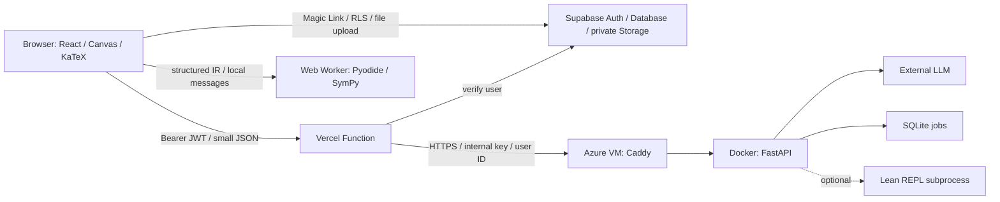

# Math Notebook Unified Design Specification v2.0

2026-10-24 · Implementation baseline · English

## 1. Purpose and scope

Math Notebook is a web application that transcribes handwritten mathematical working faithfully, checks consistency with preceding expressions using a computer algebra system (CAS), and supports the student's own revision through evidence and progressive hints. It provides verified AI completion, exercise-sheet import, and LaTeX document export that preserves verification states. An optional Lean feature handles formal proofs of more advanced mathematical propositions.

This document defines product requirements, Must/Should/Could scope, infrastructure integration, data and API contracts, state transitions, acceptance criteria, and development order. Application implementation requires no other design document or existing implementation. The infrastructure owner provisions and configures cloud resources; the application owner implements the integration contracts specified here.

Implementation, source-code generation, schema generation, migration creation, test-code and image/PDF asset creation, container-image creation, and deployment begin after the Hack Day development period starts. Requirements and design are the activities performed beforehand. Types, JSON, and diagrams in this document specify contracts; they do not represent completed implementation or executed tests.

### 1.1 Product principles

| ID | Principle | Implementation constraint |
|---|---|---|
| P-01 | Separate computational verification from proposition proving | CAS checks line calculations and transformations; Lean proves explicitly stated mathematical propositions. LLMs transcribe/generate rather than judge. Store the two kinds of results separately |
| P-02 | Preserve written mistakes | Recognition never repairs coefficients, signs, indices, omissions, or source typos. Display IR is not simplified |
| P-03 | Preserve student control | Manual confirmation is the default. AI content is committed only through explicit adoption after verification |
| P-04 | Evidence satisfies assumptions | Check the number domain, positivity, integrality, intervals, and expression domains |
| P-05 | Make uncertainty explicit | Numerical agreement alone cannot establish ok. Unverified ancestors remain visible downstream |
| P-06 | Hints do not contain the answer | Hints exclude the missing expression, coefficient, term, or solution. Unresolved errors block completion |
| P-07 | Preserve mistakes as revision history | Revisions are separate lines; original mistakes remain as history. Undo may cancel the original operation |
| P-08 | Isolate optional features | Must remains executable and testable with every Should/Could feature disabled |

### 1.2 Non-goals

Automatic problem solving, automatic correction of mistakes, answer-key comparison or overall grading, handwriting-style formatted output, permanently split input/output screens, gesture controls, comprehensive Lean formalization, dedicated hardware, collaborative editing, real-time cross-device synchronization, unrestricted editing of past lines, a user-selectable implication/equivalence mode, and user-supplied LLM API keys are outside scope. Learning effectiveness is not represented as experimentally established.

## 2. Priorities and feature boundaries

### 2.1 Must

| ID | Requirement | Acceptance tests |
|---|---|---|
| M-01 | Single canvas, pen, stroke eraser, line clearing, manual confirmation | MT-01 |
| M-02 | Non-corrective handwriting recognition and in-place LaTeX rendering | MT-02 |
| M-03 | Problem card, presets, explicit assumptions and unknowns | MT-03 |
| M-04 | Four CAS statuses, context, bindings, and unverified dependencies | MT-04–07 |
| M-05 | Evidence, error classification, two-stage recovery hints, revision | MT-08–09 |
| M-06 | CAS-verified RHS completion and next step; adopt, reject, hold | MT-10 |
| M-07 | Multi-step Undo/Redo for ink, confirmation, adoption, PDF import, and revision | MT-11 |
| M-08 | Failure preservation, deduplication, stale-response rejection, mock indication | MT-12–13 |
| M-09 | Exercise-sheet PDF import: 10 MiB, five pages | MT-14 |
| M-10 | `.tex` export preserving status, provenance, and line order | MT-15 |
| M-11 | Magic Link sign-in, authenticated relay, owner-scoped automatic save/open (ADR 0005), job infrastructure | IT-01–08 |

M-11 connects the application to its hosting platform. Custom membership administration, permission-management screens, and password-management features are not implemented.

### 2.2 Should

| ID | Feature | Flag | Dependencies |
|---|---|---|---|
| S-01 | Always-visible three-stage hint button | hints | Must context, recovery panel, jobs |
| S-02 | Hint/complete assistance modes | assist_modes | Must completion and history |
| S-03 | Bridging one to three intermediate lines | bridge | S-02 and Must CAS |
| S-04 | Reproducible graph plotting | plot | Must IR, assumptions, CAS |
| S-05 | Lean formal proofs of advanced mathematical propositions | lean | Authentication, persistence, jobs, and independent proof tasks/proposition representation |
| S-06 | Autosave and reload recovery | autosave | Must save/open |

### 2.3 Could

| ID | Feature | Flag | Dependencies |
|---|---|---|---|
| C-01 | Detect writing completion and confirm automatically | auto_submit | Must recognition, confirmation, Undo |
| C-02 | Textbook PDFs stored in Supabase (ADR 0005), exercise extraction, reference text | resources | Must problem cards and completion; S-01 integration is optional |

Effective flags are the intersection of server and frontend settings. All start OFF. Enabling the C-01 feature flag does not enable a user's auto-confirm preference, which also defaults OFF. Must imports no optional implementation module. Disabled features register no UI, API, or worker; ordinary AI and reference lines previously created by them remain readable.

Generate a frontend build registry that imports only enabled features. The Must-only build uses an empty registry, so the bundler never resolves absent Plotly/pdf.js dependencies. The server also loads enabled modules only. Create the registry generator and optional dependency locks during Hack Day.

## 3. System architecture and responsibilities



| Layer | Technology and responsibility |
|---|---|
| Frontend | Vite, React, TypeScript, Canvas Pointer Events, KaTeX, one central store |
| Relay | Vercel Node Function: JWT validation, input limits, trusted internal headers, Azure relay |
| Authentication/storage | Supabase Auth, owner-scoped Postgres snapshots, private Storage for temporary PDF transfer |
| Backend | Python 3.12, FastAPI, Pydantic; initially one container and one uvicorn worker |
| CAS | Pyodide + SymPy in a dedicated browser Web Worker; one operation per tab, terminate at five seconds |
| AI | Server-side LLM adapter; initially a Gemini model supporting structured JSON |
| Jobs | SQLite on a persistent Azure volume, independent of browser and Vercel request lifetime |
| PDF | Browser upload, pypdf validation, pypdfium2 rendering on the server |
| Optional visualization | Plotly.js basic and pdf.js, loaded on demand |
| Formal proofs | Lean 4, Mathlib, REPL; independent proof tasks, pinned toolchain and Mathlib commit |

The infrastructure owner supplies Vercel, Supabase, Azure VM, DNS/TLS, NSG, Docker/Caddy, volumes, and secret configuration. The application owner builds the gateway, sign-in UI, APIs, models, DB/RLS migrations, workers, Dockerfile, and integration tests. Resource provisioning and configuration are also scheduled after development begins.

CAS runs locally in the browser. Server APIs for LLMs, PDFs, Lean, etc. use same-origin `/api/v1/*` only. Direct Supabase access is limited to Auth and RLS-protected DB/Storage. Caddy receives HTTPS on 443 and proxies to host `127.0.0.1:8000`. FastAPI listens on container `0.0.0.0:8000`. Host port 8000 is not Internet-accessible.

### 3.1 Initial CAS implementation

Retain the mathematical rules and IR in Sections 6 and 9, using Pyodide + SymPy as the runtime. Create one dedicated module-type Web Worker per tab; after loadPyodide, use loadPackage('sympy') to load dependencies from the same distribution. Never execute Python on the main thread. [Pyodide Web Workers](https://pyodide.org/en/stable/usage/webworker.html), [package loading](https://pyodide.org/en/stable/usage/loading-packages.html)

During Hack Day, fully pin a tested Pyodide version. Match the npm loader and indexURL distribution's WASM, standard library, lockfile, and SymPy package to that release. Use a configured, versioned HTTPS CDN directory, never latest or a user-provided URL. Permit only the adopted distribution, workers, and required WASM execution in CSP, and test the deployed environment. Load the fixed CAS Python module from the application's own origin. Record both Pyodide and SymPy versions in Proof.cas.version.

Expose loading / ready / failed, with a thirty-second startup limit that terminates the worker on expiry. Defer verification/completion until ready; retain ink and recognized IR and offer retry after failure. Record initial downloads/startup separately from the five-second execution limit. Pass only validated IR and structured data to the worker and invoke fixed Python functions, never credentials or arbitrary Python code. Initially provide no Azure CAS, CAS HTTP routes, or persistent verification cache.

## 4. Authentication, persistence, and file transfer

### 4.1 Magic Link

The sign-in screen contains an email field, send-link action, delivery status, and resend action. Use existing Supabase users and disable public signup. Call `signInWithOtp` with `shouldCreateUser:false` and an allowed `emailRedirectTo=<origin>/auth/callback`. Sending the email does not establish a signed-in session. [Supabase passwordless email](https://supabase.com/docs/guides/auth/auth-email-passwordless)

The SPA uses the Supabase SDK's standard implicit flow and URL session detection. On callback, wait for the SDK to establish the session, remove authentication information from the URL, and navigate to the notebook. Do not mix in a custom code exchange or PKCE callback. Expired/used links and missing email offer resend. During Hack Day, verify email delivery and tablet navigation, SMTP, sending limits, Site URL, and redirect allowlist.

The browser sends its access token as a Bearer credential. For every request, the gateway validates it using Supabase `getUser(token)` and takes the returned user.id as the identity. Neither a browser-supplied identity nor server-side `getSession()` alone authorizes a request. The SDK manages session storage and refresh. [Supabase getUser](https://supabase.com/docs/reference/javascript/auth-getuser)

Use one Supabase client in the browser application. Create Function clients per request without persisting or globally sharing user sessions. The callback and SDK auto-detection must not process the same authentication response twice.

Explicit sign-out checks unsaved changes and clears that user's memory and local data. Session expiration preserves ink and requests reauthentication; retry after the same user returns. Switching users never displays the previous user's notebook.

### 4.2 Gateway and internal authentication

The gateway validates method/path allowlists, the 2 MiB JSON limit, and JWTs. Discard browser-provided `X-API-Key`, `X-User-Id`, and internal URLs. Recreate trusted headers using the validated user.id and server-held BACKEND_API_KEY. Azure compares the key in constant time and scopes jobs by owner.

Forward only to the fixed HTTPS BACKEND_URL. Do not implement a browser-configurable destination proxy. The application request deadline is nine seconds, and the Vercel Function must allow at least ten seconds. Job creation/status normally returns within one second. Set `Cache-Control: private, no-store`. Authentication and computation responses are not CDN-cached.

Only APP_ENV=local may use a fixed loopback HTTP origin as BACKEND_URL. Production requires HTTPS and cannot enable this exception.

Rewrite `/api/v1/*` to one `api/gateway.ts` before SPA fallback. Route `/auth/callback` to the SPA. Test that API 404s do not become index.html responses with status 200 and that direct gateway access performs identical validation. Do not expose the internal key to browsers or add permissive cross-origin backend access.

### 4.3 Notebook persistence

Create the following single application table in Supabase. Manage user provisioning through Supabase Auth; no custom membership table is required.

| mn_notebooks column | Type and constraint |
|---|---|
| id | UUID primary key, equal to snapshot.id |
| owner_id | UUID referencing auth.users; immutable after creation |
| title | text, 1–200 characters |
| schema_version | text, `2.0.0` |
| revision | bigint, initially 1; increments by exactly one |
| snapshot | JSONB object, matching schema_version, text representation at most 8 MiB |
| updated_at | timestamptz set by the database |

Enable RLS. Authenticated SELECT/INSERT/UPDATE/DELETE require `owner_id=auth.uid()`; INSERT and UPDATE have the same WITH CHECK. Grant no anonymous access. A trigger rejects changes to id/owner. Add an owner_id/updated_at composite index. [Supabase RLS](https://supabase.com/docs/guides/database/postgres/row-level-security)

> **Updated by [ADR 0005](../adr/0005-cloud-sync.md):** saves go through the `mn_save_notebook` RPC, which also stores each line's ink in `mn_notebook_ink` by content hash (`ink_index`) and a card `preview`; the same RLS, guard trigger and revision rule apply. Account settings live in `mn_user_settings`.

Access the table directly with the user's JWT and publishable key. Update by id, owner, and expected revision; zero returned rows indicate a conflict. Offer Reload, Save as another notebook, or Back, without silent overwrite. Snapshots exclude candidates, running jobs, undo stacks, JWTs, secrets, and signed URLs.

### 4.4 Exercise-sheet transfer

The Vercel Function request/response limit is 4.5 MB, so do not send the PDF as base64 through the gateway. Upload directly to private Storage bucket `mn-imports` and send only its reference to the API. [Vercel Function limits](https://vercel.com/docs/functions/limitations)

Use path `<user_uuid>/<notebook_uuid>/<import_uuid>/source.pdf`, maximum 10 MiB, MIME application/pdf, and upsert=false. Storage INSERT/SELECT/DELETE policies require the bucket and first path component to match auth.uid(). No UPDATE policy is granted. Use resumable TUS uploads above 6 MiB. [Supabase Storage access control](https://supabase.com/docs/guides/storage/security/access-control), [resumable uploads](https://supabase.com/docs/guides/storage/uploads/resumable-uploads)

The gateway validates the owner path and notebook ID, creates a 600-second read URL using the user's JWT, and adds it to the internal request. Azure downloads only from the configured Supabase origin and signed-read path, does not follow redirects, and verifies size, SHA-256, and timeouts. Distribute no service-role key to the browser or Azure.

After completion, the browser removes the Storage object. An infrastructure-managed runner removes abandoned objects older than 24 hours using the Storage API. Azure processing files use a dedicated temporary directory and are removed in finally. An expired source URL produces SOURCE_EXPIRED and an explicit retry action.

## 5. Shared data model

Use snake_case on the wire and in snapshots; schema_version is `2.0.0`. Notebook, request, job, verification, candidate, and client-session IDs are UUIDs. Line/stroke/problem IDs contain 1–64 alphanumeric, underscore, or hyphen characters. The following notation defines the contract; TypeScript and Pydantic implementations enforce matching constraints.

```ts
type Id = string;
type Hash = string; // sha256: + 64 lowercase hex
type MathJSON = string | number | null | [string, ...MathJSON[]];
type Status = 'ok' | 'wrong' | 'unknown' | 'none';
type Method = 'sym' | 'sets' | 'solve' | 'eval' | 'cx' | 'num' | 'def';
type Role = 'premise' | 'definition' | 'step' | 'text';
type Source = 'user' | 'ai' | 'pdf' | 'resource';
type SuggestMode = 'COMPLETE_RHS' | 'NEXT_STEP' | 'BRIDGE';
type Feature = 'hints' | 'assist_modes' | 'bridge' | 'plot' | 'lean'
  | 'autosave' | 'auto_submit' | 'resources';
type Segment =
  | {type:'text'; text:string}
  | {type:'math'; expr:MathJSON; notation:'plain'|'continuation'; latex:string};
type InputSegment =
  | {type:'text'; text:string}
  | {type:'math'; expr:MathJSON; notation:'plain'|'continuation'};
interface Stroke {
  id: Id; points: {x:number; y:number; t:number; p:number}[];
}
interface Assumption {
  symbol:string;
  kind:'real'|'positive'|'nonnegative'|'nonzero'|'positive_integer'|'interval';
  lower?:MathJSON; upper?:MathJSON; source:'user'|'adopted';
}
interface Problem {
  id:Id; title:string; statement:Segment[];
  definitions:MathJSON[]; conditions:MathJSON[];
  assumptions:Assumption[]; unknowns:string[]; independent_var?:string;
  origin?:{kind:'preset'|'pdf'|'resource'; name:string; page?:number};
}
interface Evidence {
  kind:'COUNTEREXAMPLE'|'SOLUTION_DIFF'|'DOMAIN_CONDITION'|'EXACT_MISMATCH';
  assignment?:Record<string,string>;
  context_value?:string; written_value?:string;
  missing?:string[]; extra?:string[]; condition_latex?:string;
  approx?:boolean; summary:string;
}
interface SegmentProof {
  segment_index:number; status:Status; goal?:string; method?:Method;
  reason?:string; category?:string; conditions:string[]; evidence:Evidence[];
}
interface Proof {
  status:Status; goal?:string; method?:Method; reason?:string; category?:string;
  conditions:string[]; evidence:Evidence[];
  hints:{level:1|2; text:string; refs:Id[]}[];
  segment_results:SegmentProof[];
  depends_on:Id[]; depends_on_unverified:boolean; unverified_ancestors:Id[];
  input_hash:Hash; mock:boolean;
  cas:{version:string; rules_version:'2.0.0'; elapsed_ms:number; timed_out:boolean};
}
interface Verified {verification_id:Id; input_hash:Hash; proof:Proof}
type FormalExpr = string | number | [string, ...FormalExpr[]];
interface LeanTask {
  id:Id; version:number; statement_text:string;
  variables:{id:Id; name:string; type:'Nat'|'Int'|'Real'}[];
  assumptions:{id:Id; proposition:FormalExpr}[];
  conclusion:FormalExpr;
  source_refs:{line_id:Id; version:number; adopted_as_assumption:boolean}[];
}
interface LeanPrepared {
  prepared_id:Id; task:LeanTask; statement:string; statement_hash:Hash;
  unresolved_symbols:string[];
}
interface LeanResult {
  task_id:Id; task_version:number; statement_hash:Hash;
  state:'proved'|'unproved'|'timeout'|'skipped'|'unavailable';
  statement:string; proof?:string; attempts:number; log?:string; reason?:string;
}
interface Line {
  id:Id; version:number; source:Source; role:Role;
  state:'DRAFT'|'RECOGNIZING'|'RECOGNIZE_FAILED'|'VERIFYING'|'SETTLED'|'SUPERSEDED';
  ink:Stroke[]; segments:Segment[]; parent_id?:Id; verified?:Verified;
  failure?:{stage:'recognize'|'verify'; code:string};
  revision_of?:Id; recovery_root_id?:Id; superseded_by?:Id;
  ai_origin?:{candidate_id:Id; mode:SuggestMode};
  document_origin?:{name:string; page:number; has_unreadable:boolean};
  extensions?:Record<string,unknown>;
}
interface Recovery {
  root_line_id:Id; current_line_id:Id;
  phase:'WRONG_SHOWN'|'EVIDENCE_OPEN'|'HINT_FOCUS'|'HINT_LOCATE'
    |'REVISING'|'REVERIFYING'|'RECOVERED'|'UNRESOLVED';
  opened_at:Partial<Record<'evidence'|'hint1'|'hint2'|'revise'|'recovered',number>>;
}
interface Notebook {
  schema_version:'2.0.0'; id:Id; title:string; mode:'live'|'mock';
  domain:'Reals'; problem:Problem; lines:Line[]; recoveries:Recovery[];
  extensions?:Record<string,unknown>;
}
interface Meta {
  request_id:Id; notebook_id:Id; client_session_id:Id; client_epoch:number;
  line_id?:Id; line_version?:number; context_fingerprint:Hash;
}
interface Target {
  id:Id; role:Role; segments:InputSegment[];
  revision_of?:Id; recovery_root_id?:Id;
}
interface Context {
  problem:Problem; domain:'Reals'; mode:'live'|'mock'; parent_line_id?:Id;
  lines:(Target & {verification_id:Id; input_hash:Hash})[];
}
interface CandidateDraftResult {
  state:'GENERATED'|'NONE'; reason?:string;
  candidate?:{id:Id; mode:SuggestMode; content_hash:Hash;
    lines:{target:Target; segments:Segment[]}[]};
}
interface CandidateLine {target:Target; segments:Segment[]; verified:Verified}
interface CandidateResult {
  state:'READY'|'NONE'; reason?:string;
  candidate?:{id:Id; mode:SuggestMode; content_hash:Hash; lines:CandidateLine[]};
}
interface Job<T = unknown> {
  id:Id; kind:string; state:'queued'|'running'|'succeeded'|'failed'|'cancelled'|'expired';
  phase:string; meta:Meta; created_at:string; expires_at:string;
  result?:T; error?:{code:string; message:string; retryable:boolean};
}
type ApiResponse<T> =
  | {ok:true; request_id:Id; data:T}
  | {ok:false; request_id:Id; error:{code:string; message:string;
      retryable:boolean; retry_after_ms?:number}};
```

Stored Proof objects are historical display results. verification_id is a local reference issued by the browser CAS controller, not a server certificate or authorization credential. Keep the cache in tab memory, scoped by user/notebook, and match content, input_hash, and runtime versions before using results as mathematical context. After opening a snapshot or losing the cache, reverify locally in order rather than trusting saved status alone. Do not repeat recognition. The server does not infer mathematical correctness from these references.

Proof/Verified describe CAS reports. LeanTask/LeanResult are separate data and require no CAS verification_id. Persist proof tasks, confirmed formal statements, and results under Notebook.extensions.lean_tasks; omit running job IDs from snapshots.

### 5.1 Limits and extensions

| Object | Limit |
|---|---|
| API JSON and response | 2 MiB UTF-8 |
| Recognition image | 1 MiB decoded, longest side 1000 px, PNG/JPEG |
| IR | 256 nodes, depth 24, integer magnitude 10¹², integer exponent magnitude 100 |
| One line | 16 segments, eight math segments, 4000 prose characters, 20,000 ink points |
| Context | 64 active mathematical lines, 16 conditions/definitions each, 32 assumptions, three unknowns |
| Snapshot | 8 MiB; check the DB representation too, preserving content on save failure |
| Reference text | 9000 Unicode characters total |

Represent mathematical decimals as exact Divide expressions. Numerical NaN/Infinity is forbidden; only plotting and ink accept finite floating-point values. Reject unknown LLM fields. Preserve unknown snapshot extension keys without executing unknown features.

## 6. Mathematical IR and conversion

Unnormalized MathJSON expr is the sole mathematical content representation. Preserve term order, signs, grouping, and omissions. Symbol names match `[A-Za-z][A-Za-z0-9_]{0,31}`. Do not evaluate or simplify the stored IR.

| Operator | Arguments and meaning |
|---|---|
| Add, Multiply | 2–16 expressions |
| Subtract, Divide | Two expressions |
| Negate, Sqrt, Abs, Sin, Cos, Tan, Exp, Ln | One expression |
| Power | Base and integer exponent; non-integer exponents are UNSUPPORTED |
| Equal | LHS and RHS; null is permitted only for an empty RHS |
| EqualChain | 3–8 expressions; preserved for display, verification UNSUPPORTED |
| Less, LessEqual, Greater, GreaterEqual, NotEqual | Two expressions |
| And, Or | 2–16 relations |
| PlusMinus, Set | Center and offset / 0–16 set elements |
| D | Expression and differentiation variable; nest for higher derivatives |
| Prime | Function name and argument symbol; first derivative of a defined function |
| Apply | Function name and argument expression |
| Integrate | Integrand and `[Tuple,variable,lower,upper]` |
| Evaluate | Expression and `[Tuple,variable,lower,upper]`; upper value minus lower value |
| Sum | Expression and Tuple; preserved/displayed, Must verification UNSUPPORTED |
| Limit | Expression and `[LimitSpec,variable,value,"both"/"left"/"right"]`; display only |
| Unreadable | No arguments; renders as a square placeholder |
| Constants | Pi, ExponentialE, ImaginaryUnit, Hbar; Infinity only for bounds/limit values |

Tuple and LimitSpec occur only in their designated positions, never as standalone mathematics. Distinguish symbols from constants; invalid operators never become arbitrary function calls. Root null, empty LHS, invalid arity, and excessive resources produce IR_INVALID. During recognition, preserve ink and report failure. Valid IR whose semantic operation is unsupported receives unknown.

Continuation uses `notation=continuation` and the expression on the right. `=x²+x` has expr `[Add,[Power,x,2],x]`; the serializer adds the initial equals sign. The empty RHS `I(a)=` becomes `[Equal,[Apply,I,a],null]` and always receives unknown/INCOMPLETE.

Convert line IR independently into LaTeX and SymPy. The server generates LaTeX; the frontend regenerates saved content with an identically specified printer. Test both languages against identical fixed cases. Never reparse display LaTeX as CAS input. Construct SymPy objects by operator dispatch, never arbitrary-string eval, sympify, or parse_expr. Lean uses the typed proposition representation in Section 14.4, importing relevant portions of line IR when needed.

Evaluate renders as `\left[F(x)\right]_{l}^{u}` and converts to the difference between substitutions at upper and lower bounds. Do not replace the stored F with its simplified result.

Exclude bound variables of Integrate/Evaluate/Sum from free-symbol and unknown inference. Function substitution must avoid variable capture and must not apply outer bindings to bound variables. Visitors distinguish free and bound occurrences.

## 7. APIs, jobs, and asynchronous control

### 7.1 Protocol

The base path is `/api/v1`; authentication is required. POST bodies are `{meta:Meta,input:...}` with a UUID Idempotency-Key header. Responses use ApiResponse. Job creation returns 202 with `{job:Job}`; synchronous operations return 200 with `{meta,...result}`. Mathematical wrong is an API success, not an HTTP failure.

| HTTP and path | input | Result |
|---|---|---|
| GET /capabilities | None | schema_version, build_id, every feature boolean, cas_runtime=pyodide, LLM/Lean status |
| GET /health | None | status, build_id, LLM configuration, Lean ready; CAS readiness is browser-local; no secrets |
| POST /recognize | image, previous_math_latex?, ui_lang, prefetch | Job → `{segments,unreadable,mock}` |
| POST /suggest | context, mode, based_on_line_id, target_line_id, lhs_expr?, bridge_to?, rejected_hashes, reference? | Job → CandidateDraftResult |
| POST /pdf/imports | object_path, file_name, bytes, sha256, ui_lang | Job → `{pages:[{page,lines:[{segments,has_unreadable}]}],mock}` |
| GET /jobs/{id} | None | `{job}`, same owner required |
| DELETE /jobs/{id} | None | `{job}`; cancel queued/running, leave terminal states unchanged |
| POST /hints | context, after_line_id, level, ui_lang, reference? | S-01 job → hint |
| POST /lean/prepare | Task description, known variables/assumptions/conclusion, source_refs | S-05 job → LeanPrepared for formalization review |
| POST /lean/jobs | prepared_id, confirmed_statement_hash | S-05 job → LeanResult for the confirmed proposition |
| POST /resources/page | page, image, ui_lang | C-02 job → page segments |
| POST /resources/problems | page, page_text, ui_lang | C-02 job → problems |

The local CAS controller's asynchronous verify interface accepts `{meta,context:Context,target:Target}` and returns `{meta,verified:Verified}` from the worker. S-04 plot passes context, target, and settings to the same worker. Do not implement HTTP /verify or /plot. The controller validates local references in Context and expands their matching verification reports into worker-internal data. Apply Section 7.3 response matching to both.

For verify, context.lines contains only active lines before the target. A revision excludes the erroneous source and uses its original parent. Suggest receives every active line; the browser checks the error lock and local verification references before sending. The server validates the input and uses the prefix through based_on_line_id as generation context. RHS completion uses the prefix preceding the incomplete line. meta.line_id identifies the initiating line; NEXT_STEP target_line_id is a reserved new ID. The local CAS controller issues candidate verification for its final adoption target ID.

### 7.2 Job execution

Persist owner, kind, idempotency key, input digest, payload, state, phase, timestamps, and result/error in SQLite before returning 202. Enforce unique(owner,kind,key). The same key/input returns the same job; changed input returns 409. Exclude expiring source URLs and request_id from input-identity comparison. Local verify reuses results through the Section 7.3 cache.

Reuse the key when retrying a request whose response was lost. After confirming terminal failed/cancelled/expired, an explicit user restart creates a new key. Re-upload deleted PDF sources and issue a fresh valid read URL.

```text
queued -> running -> succeeded / failed
queued / running -> cancelled
queued -> expired
```

Queue wait is limited to 30 seconds. Execution limits: recognition 45 s, completion 60 s, PDF 180 s, hint 15 s, Lean formalization 45 s/proving 90 s, resource page/problems 45 s. Execution timeout fails the job; Lean proving should return its timeout result normally when possible. Retain results for one hour and deduplication keys for 24 hours. Expired results return 410, without automatically creating another paid job.

Run one dispatcher in FastAPI lifespan with one uvicorn worker and SQLite WAL. Claim jobs transactionally using a conditional state update. Limit concurrent LLM calls to two, Lean to one, unfinished jobs per user to four, and the total waiting queue to 32. Prioritize recognition over background work; excess requests receive 429.

On restart, fail running jobs with WORKER_RESTARTED rather than automatically rerunning external operations. Resume queued jobs only while valid. Cancellation updates DB state, terminates child processes, and attempts to cancel external LLM calls. Check cancellation again before committing a result; cancelled jobs never return to succeeded.

Poll every second initially, two seconds after ten seconds, and five seconds after thirty seconds; stop at terminal states. After token refresh, query the same job ID. Validate each job result against its kind-specific schema.

Job.meta retains the original submission metadata rather than the outer polling response's request_id. Match asynchronous results to the active slot using Job.meta.

### 7.3 Response matching and caching

For line-scoped recognition/CAS/completion operations, apply results only when request_id, notebook_id, client_session_id, client_epoch, line_id, line_version, and context_fingerprint match the active request slot. Prefetch also matches stroke hash. Undo, confirmation, revision start, problem/mode change, and notebook switch increment epoch, abort relevant requests, and cancel known jobs. Stale responses update neither UI nor history caches. Match independent Lean tasks as specified in Section 14.4.

Separate mathematical cache identity from transport identity. Canonical JSON sorts object keys, preserves array order, omits insignificant whitespace, uses UTF-8, decimal integers, and preserved Unicode. Mathematical payloads contain no floats.

- Semantic hash: notebook ID, mathematical problem content, domain, live/mock, active ancestor IDs/roles/IR/notation/revision links/mathematical proof digests.
- input_hash: rules/CAS versions, semantic hash, target ID/role/IR/notation/revision links, parent ID.
- context_fingerprint: semantic hash, session ID, epoch, line versions.
- Candidate hash: mode and candidate IR/notation; rejection history is context-scoped.

Exclude elapsed_ms, UI expansion, ink, and transport versions from mathematical digests. Lookup tab-memory verification by owner/notebook/input_hash and validate each historical result against its own preceding prefix. Undo/Redo can reuse identical content while advancing transport generations. Missing or mismatched cache entries produce the local control code CONTEXT_REVERIFY_REQUIRED; recheck from the first invalid line onward.

### 7.4 Errors

| HTTP | code | User action |
|---|---|---|
| 400 | INVALID_REQUEST, IR_INVALID, IMAGE_INVALID, PDF_CORRUPTED_OR_ENCRYPTED | Correct input, retain content |
| 401 | AUTH_REQUIRED, TOKEN_INVALID | One SDK refresh, then Magic Link sign-in |
| 403 | FEATURE_DISABLED, BACKEND_KEY_INVALID | Show feature/configuration issue |
| 404 / 410 | NOT_FOUND / JOB_EXPIRED | Other owners' jobs return 404; expired results offer retry |
| 409 | IDEMPOTENCY_CONFLICT, SUGGEST_NOT_AVAILABLE | Update operation/context |
| 413 | PAYLOAD_TOO_LARGE, PDF_TOO_LARGE, PDF_PAGE_LIMIT_EXCEEDED, RESULT_TOO_LARGE | Explain limits |
| 422 | ASSUMPTIONS_INVALID, SNAPSHOT_INVALID | Correct assumptions/snapshot |
| 429 | RATE_LIMITED, QUEUE_FULL | Respect retry_after_ms |
| 502 / 503 / 504 | UPSTREAM_INVALID, BACKEND_UNAVAILABLE, LEAN_UNAVAILABLE, GATEWAY_TIMEOUT | Explain dependency failure; resume with the same key |

Job errors also include UPSTREAM_TIMEOUT, UPSTREAM_429, UPSTREAM_AUTH, SCHEMA_INVALID, WORKER_RESTARTED, SOURCE_EXPIRED, and PDF_TRANSCRIPTION_INCOMPLETE. CAS_BUSY, CAS_UNAVAILABLE, CONTEXT_REVERIFY_REQUIRED, UNRESOLVED_WRONG, and LINE_IS_WRONG are local control codes for feedback/retry, without HTTP requests. CAS TIMEOUT is a Proof.reason, distinct from HTTP failure.

## 8. Must: input, recognition, and screens

### 8.1 Screen and ink

The top bar contains the problem card, connection state, live/mock, and sign-out. The main area is one ruled notebook. Put Confirm/Undo/Redo/New line beside the active line, and judgment/provenance beside settled lines. The bottom toolbar contains Pen/Eraser/View, AI completion, PDF, Save, Open, and LaTeX export. Panels open as overlays. Touch targets are at least 44 px, and judgments use color, icons, and text.

Use Pointer Events, pointer capture, high-DPI scaling, and coalesced events when available. Store line-local logical x/y, time t, and pressure p; missing pressure defaults to 0.5. Initial line height is 140 CSS px. Ignore touch drawing during pen use. View mode scrolls; the eraser removes whole intersected strokes. Buttons are outside Canvas.

Only DRAFT ink is editable. Empty confirmation is harmless; duplicate confirmation during processing is ignored. New line preserves the draft and moves to another draft without submitting. Pausing never submits. Recognition mistakes can be corrected by Undoing back to ink.

### 8.2 Recognition

Freeze ink at confirmation, create the bounded image, and submit a recognize job. AI-R returns InputSegment[] and unreadable only. It does not repair coefficients, signs, indices, or an empty RHS. Previous mathematics is used solely to disambiguate similar symbols. Ignore crossed-out writing and treat image text as data.

Represent a partially unreadable token at its position using Unreadable. Completely unreadable input returns empty segments/unreadable=true. Whole-line unreadability and schema violations fail recognition while preserving ink; partial unreadability is displayed and receives unknown. The server validates IR, generates LaTeX, and replaces the visible ink in place, retaining strokes for history.

KaTeX uses trust=false. Do not hide rendering failures by substituting another expression. After successful recognition, run verify. Retrying verification does not resubmit the image.

### 8.3 Problem card

> Superseded by [ADR 0006](../adr/0006-problems-are-lines.md): there is no problem card; a notebook's problem is its opening lines, marked as given, and assumptions and function declarations are lines recognised by shape.

Show the statement, definitions, conditions, unknowns, independent variable, and assumptions. Supply three presets: definite integration, expansion, and missing solutions. PDF conditions require explicit adoption. Unreadable formulas cannot become conditions or definitions. This version uses real numbers.

Prevent assumption changes during writing/processing. Committing changed assumptions invalidates all active results and rechecks them in order; completion remains disabled until this finishes. Check unsaved changes before opening another problem.

Ordinary mathematical lines use role=step, prose uses text, and references use premise. Explicitly select definition from line details when introducing a new definition. Identical transcriptions of problem definitions are classified DEFINITION by CAS and displayed accordingly.

## 9. Must: CAS verification

### 9.1 Context

Use active parents/ancestors, adopted problem definitions/conditions/assumptions, and verified bindings. Future lines never enter a target's mathematical context. A revision is checked against its source's original parent/context, not the erroneous source itself.

Register a binding only from an ok segment that uniquely expresses `unknown=expr`. Do not create self-referential bindings or expressions containing unresolved other unknowns. Compare defined functions by substituting their definitions. Never use the target's own previous binding circularly to justify it.

An unknown parent may still support a rigorously verified local step. Propagate ancestor IDs whenever a used parent, definition, or binding is unknown or already depends on unverified content. Preserve this annotation on wrong as well as ok.

### 9.2 Goal selection

| Order | Condition | Result/goal |
|---|---|---|
| 1 | Text only | none / TEXT_ONLY |
| 2 | Premise/reference | none / PREMISE; unreadable material is not adopted |
| 3 | Unreadable/incomplete/empty RHS | unknown / UNREADABLE or INCOMPLETE |
| 4 | New explicit definition or identical transcription of a problem definition | none / DEFINITION; conflicting redefinition is UNSUPPORTED |
| 5 | First expression without a comparison source | none / NO_PARENT |
| 6 | Continuation | EXPRESSION_EQUIVALENCE |
| 7 | Value of a defined function/symbol/derivative | EQUATION_FROM_CONTEXT |
| 8 | Linear system expressed with And | SYSTEM_SOLUTION, at most three unknowns |
| 9 | Relational parent and target | SOLUTION_SET_EQUIVALENCE |
| 10 | Exact constant comparison | CONSTANT_EVALUATION |
| 11 | Other | unknown / UNSUPPORTED |

Declared unknowns take precedence. Otherwise remove independent variables and assumption-bearing parameters from free symbols. Ambiguity yields AMBIGUOUS_UNKNOWNS. Integrate and Evaluate are evaluated inside these goals.

### 9.3 Judgment rules and execution limits

Return ok only for symbolic zero difference under assumptions, equal solution sets, or exact equal constants, with unchanged domains. Return wrong only with an assumption-valid counterexample, concrete solution-set difference, or exact constant mismatch. Failure to simplify to zero is not proof of wrong. Numerical agreement alone yields NUM_ONLY; neither proof nor counterexample yields NO_EVIDENCE.

Equation transformations compare solution sets. `x²=4 → x=2` loses a solution; the reverse adds one. Two empty real solution sets are equal, but this result is not a complex-domain result. Distinguish equivalence from implication.

Preserve denominator/root/log domain information from unsimplified IR. `(x²-1)/(x-1) → x+1` receives unknown/DOMAIN_CHANGED and condition x≠1. It is not unconditionally ok until assumptions are explicitly updated and checked. Contradictory assumptions produce ASSUMPTIONS_INVALID.

Limit the entire CAS operation, including goal/evidence/classification, to five seconds from dispatch to a ready worker. A main-thread timer calls Worker.terminate(); timeout gives unknown/TIMEOUT and an executing worker failure gives unknown/CAS_ERROR. When tab timers are throttled, check elapsed time on resume and reject overdue results. Allow one operation per tab; busy requests return local CAS_BUSY and remain retryable. The controller serializes candidate-chain checks. Cancellation during execution also terminates the worker. Recreate the worker after termination and require explicit retry of unfinished work. Preserve existing lines, results, and Undo history. SharedArrayBuffer interrupts and COOP/COEP configuration are not initial requirements.

Support differentiation, definite integrals over finite intervals, Evaluate, and algebra. Indefinite-integral families, general ODE/PDEs, and infinite series are UNSUPPORTED. Even supported syntax receives unknown if verification cannot finish within the budget.

### 9.4 Evidence, classification, and multiple expressions

Try counterexample values 0, 1, -1, 2, -2, 3, 1/2, -1/2, 1/3 in order. Bind parameters first, then interval endpoints and simple interior points. Check positivity, integrality, intervals, and every related expression's domain. Continue past agreement points; stop at 200 assignments or one second. Prefer exact arithmetic. Approximate disagreement is acceptable only when stable at increased precision and larger than evaluation error, and must be marked approx=true.

Classification is CAS-only. Solution differences produce MISSING_SOLUTION/EXTRA_SOLUTION. Ratio -1 means SIGN; an independent-variable-free ratio other than ±1 means COEFFICIENT; a nonzero constant difference means CONSTANT_TERM. For an Integrate-to-Evaluate error, classify INTEGRATION_TERM only when the proposed primitive's derivative differs by terms from the integrand and the definite-integral/Evaluate values are also proven unequal. Domain issues use DOMAIN; other cases use UNCLASSIFIED.

Verify multiple math segments independently against the same input context and store segment_results. Do not silently treat an earlier segment as a premise for a later segment. Aggregate wrong first, then unknown, then ok; all none gives none. Display segment details; only individually ok segments can produce bindings. A definition line contains one math segment.

## 10. Must: error recovery

Immediately after wrong, display only the category. Show Evidence opens Evidence; Hint 1 opens the focus; Hint 2 opens the location. Format CAS-computed numbers and solution differences with templates. LLMs do not invent evidence.

| Category | Hint 1 | Hint 2 |
|---|---|---|
| INTEGRATION_TERM | Check that each term in the integrand has a corresponding term after integration. | Match each integrand term to the expression inside this line's brackets. |
| COEFFICIENT | Check the constant factor multiplying the expression. | Check where the symbol from line {binding} enters the definition. |
| SIGN | Check the signs. | Trace differentiation, transposition, or expansion from the parent line. |
| CONSTANT_TERM | Check the term independent of the variable. | Match the parent's constant part to this line. |
| MISSING_SOLUTION | Check that all values satisfying the preceding line remain. | Review whether taking roots or dividing removed a solution. |
| EXTRA_SOLUTION | Check that this line's solutions satisfy the preceding line. | Review whether squaring or multiplying introduced solutions. |
| UNCLASSIFIED | Check each transformation separately. | Split the step across two lines for comparison. |

Template slots contain existing symbol names and line numbers only. Hints exclude textual forms of the missing coefficient/term/solution and mathematical fragments that would receive CAS ok in place of the target. Test all templates for leakage. Must does not use unrestricted LLM rephrasing of recovery hints.

Revise is available at every stage and creates a DRAFT directly beneath the source. Set revision_of/recovery_root_id and verify against the same parent. Once the revision is confirmed, exclude the old line from comparisons but retain it as history. Only an ok revision produces RECOVERED; unknown is UNRESOLVED; wrong restarts with new evidence. Any unresolved recovery group blocks every completion mode.

Display ok without ancestors as Verified; with ancestors as Local step consistent (unverified: line N). Display wrong with its category, unknown with its reason, and none as premise/definition/text. Recognition and transport errors are not mathematical mistakes.

## 11. Must: AI completion

COMPLETE_RHS structurally preserves the incomplete line's LHS and checks the completed expression against the preceding active line/problem context. NEXT_STEP requests one small step after the latest settled ok/none, or unknown with TIMEOUT/NO_EVIDENCE/NUM_ONLY/UNSUPPORTED. Local steps from unknown preserve ancestor annotations. Unreadable, incomplete, pending-recheck, or unresolved-revision states cannot initiate it.

Send the problem card, up to eight recent active lines, mode, LHS, and rejected hashes. Receive one line of InputSegment[] or null. Discard prose-only output, changed LHS, invalid IR, and exactly repeated IR/notation from existing/rejected lines. Do not reject merely because CAS considers a transformation equivalent to an earlier expression: equivalence is the purpose of the step.

The server returns only an unverified CandidateDraftResult. The browser rechecks the current context and verifies candidates with local CAS; only ok becomes a READY CandidateResult. Unknown/wrong candidates cannot be displayed or adopted. If context contains unresolved wrong or an unknown revision, the browser blocks the LLM request with local UNRESOLVED_WRONG. Repeat the guard and input_hash checks at adoption.

Use dashed candidate rendering with AI origin, unadopted state, and verification state. Results arriving during handwriting become HELD; resume READY only after writing stops with unchanged context. Confirmation, Undo, or context changes produce STALE. Adoption is single-use. NEXT_STEP creates a new line; COMPLETE_RHS updates the target RHS. Preserve AI origin and original ink. Rejection changes no confirmed line and prevents the identical candidate from reappearing in that context.

## 12. Must: state, history, and input/output

### 12.1 State transitions

```text
Line:
DRAFT -> RECOGNIZING -> VERIFYING -> SETTLED
RECOGNIZING -> RECOGNIZE_FAILED -> retry / DRAFT
SETTLED -> VERIFYING (recheck)
original wrong line -> SUPERSEDED (revision confirmed)

Recovery:
WRONG_SHOWN -> EVIDENCE_OPEN -> HINT_FOCUS -> HINT_LOCATE
any stage -> REVISING -> REVERIFYING -> RECOVERED / UNRESOLVED / WRONG_SHOWN

Candidate:
GENERATING -> VERIFYING -> READY / NONE; GENERATING -> NONE; READY <-> HELD
READY -> ADOPTED / REJECTED; pending states -> STALE on context change
```

An unavailable/uninitialized CAS or startup failure sets failure.stage=verify and offers Recheck. CAS timeout settles as unknown. Every operation ends in success, failure, timeout, or cancellation.

### 12.2 Undo/Redo

Commands contain serializable before/after differences, target IDs, and completed segments/Verified results. Store no executable functions in DB. past/future supports ADD_STROKE, ERASE_STROKES, CLEAR_DRAFT, ADD_DRAFT, CONFIRM_LINE, START_REVISION, ADOPT_CANDIDATE, REJECT_CANDIDATE, IMPORT_PDF, and EDIT_PROBLEM.

Push confirmation at request start. Update after only while that command remains active. Undo during processing cancels requests/jobs and rejects delayed results. Redo of a completed operation restores cached content with zero resubmission. Redo of an unfinished command restores ink and an explicit retry state, not automatic paid execution. New edits clear future; empty-stack operations are harmless.

Content may move backward, but epoch and line versions increase monotonically. Validate mathematical reuse with separate hashes. Save/export/evidence expansion do not enter edit history.

### 12.3 PDF import

Check size/hash and use the transfer path in Section 4. Azure validates the 10 MiB/five-page limit, corruption, and encryption using pypdf, then renders each page to at most 1000 px on the longest side. AI-P preserves page order, prose/math separation, typos, and unreadable markers. Budget 25 s and 2000 output tokens per page, 180 s overall. Never commit truncated or partial transcription as success.

After preview, Apply to problem card or Add reference lines commits one IMPORT_PDF command. Imported lines are source=pdf/role=premise and visibly unverified reference material. Unreadable formulas cannot become premises. If notebook limits would be exceeded, let the user select lines. Failure/cancellation leaves existing content and concurrently written ink unchanged.

### 12.4 Save/open

Snapshots preserve the problem, lines/ink, results and verification references, provenance, recovery state, and optional settings. They exclude history, candidates, and running jobs. Edits made during a save remain dirty. On open, validate schema, turn processing lines into retryable states, and start with empty history. After opening, reverify in order using CAS only if the local cache is absent.

Must saves explicitly. Show navigation warnings and notebook-switch confirmation for unsaved changes. Saving failure or session expiration never clears content.

### 12.5 LaTeX export

A pure serializer generates UTF-8/LF/no-BOM `.tex` without LLMs, backend calls, or a TeX compiler. Identical snapshots produce identical bytes; insert no current timestamp. Target LuaLaTeX with ltjsarticle, amsmath, and amssymb.

Export problem/assumptions, displayed derivation order, states, and AI/PDF provenance. Escape prose `\ { } $ & # ^ _ ~ %`; use IR-generated LaTeX for math. Comment every physical line of superseded content with `%`, retaining unresolved wrong lines in the body. Annotate unknown, unverified ancestors, and mock precisely. Draft/recognition-failure lines become comments and an on-screen notice rather than fabricated formulas. Do not export ink images or hints. Preserve source notebook/history unchanged.

## 13. LLM task contracts

Place static instructions before image/reference/notebook data. Treat all content as data and reject anything outside the specified JSON. LLM outputs contain no display LaTeX, CAS proof, or correctness status. Encapsulate provider details in the adapter; mocks pass the identical schemas.

| Task | Output | Temperature | Token limit | Per-call timeout |
|---|---|---|---|---|
| AI-R | `{segments:InputSegment[],unreadable:boolean}` | 0 | 600 | 20 s |
| AI-S | `{candidate:InputSegment[][] or null}`, one line in Must | 0.2 | 600, BRIDGE 1400 | 20 s |
| AI-P | `{pages:[{page,lines:[{segments,has_unreadable}]}]}` | 0 | 2000/page | 25 s |
| AI-HB | `{template_id,ref_ids,symbol?}` | 0 | 150 | 10 s |
| AI-LF | `{statement_text,variables,assumptions,conclusion}`: typed formalization proposal | 0 | 1400 | 20 s |
| AI-LP | `{plan}`: structured proof plan | 0 | 1800 | 20 s |
| AI-PR | `{problems:[{id,title,statement,statement_segments,page}]}` | 0 | 2000/page | 20 s |

Retry 429/5xx/network timeout at most once; cap retry-after at ten seconds and respect the job deadline. Do not automatically retry 400/401/403/schema violations. If provider schemas cannot express recursion, relax only the transport declaration and retain strict Pydantic validation. Truncation and empty responses are not success. Mark mock in UI, persistence, export, and logs; never mix it into live verification context.

## 14. Should details

### 14.1 S-01: three-stage hints

The always-visible button advances through direction, tool, and shape. Reset to level one after context changes; repeat level three after the third press. During recovery, open the recovery panel and have the hint API return LINE_IS_WRONG without invoking the LLM.

AI-HB selects a reviewed template_id and existing references/symbol only, not free prose, formulas, or numerical values. Templates are USE_CONDITION, SUBSTITUTE_DEFINITION, EVALUATE_BOUNDS, ISOLATE_UNKNOWN, EXPAND, FACTOR, and COMPARE_STEPS. Check applicability against IR and fall back to COMPARE_STEPS when unsuitable.

Level one states the goal; two references an existing condition/formula/line; three is a server-generated shape such as `I(a)=□`. Never insert a missing value into a slot. Apply the recovery leakage checks and replace failing output with generic formula-free prose. Return `{after_line_id,semantic_hash,level,template_id,text,refs,fallback}`. Store hint history outside edit history and TeX export. Failure does not advance the level.

### 14.2 S-02/S-03: modes and bridging

Default mode is complete. Hint mode hides completion; complete enables Must completion and optional BRIDGE. When S-02 is disabled, Must completion remains available. Record CHANGE_AI_MODE, increment epoch, and discard existing candidates. Do not implement automatic suggestions.

BRIDGE selects two adjacent active settled math lines and proposes one to three intermediate lines. Neither endpoint may contain unreadable content, wrong, or unresolved revision; the global completion guard also applies. Verify candidates sequentially with local CAS from the upper line, then the lower line against the last candidate. Only an all-ok chain becomes READY. A directly verified pair may still receive explanatory intermediate steps.

When bridge is OFF, mode=BRIDGE sent to the Must suggest endpoint also returns FEATURE_DISABLED. When assist_modes is OFF, ignore stored mode restrictions and keep Must completion available.

Adopt the insertion as one command, update parents and verification from the lower line onward, and block completion until rechecking finishes. One Undo restores all inserted lines, parent links, and previous judgments.

### 14.3 S-04: plots

Evaluate IR through SymPy in the CAS Web Worker and load Plotly.js basic lazily. Use no LLM or display-LaTeX parsing. Support settled function expressions, y=expr, I(a)=expr, etc. Integrals, derivatives, sums, and unresolved relations return a reason rather than a plot.

Choose x from the LHS function argument, problem independent variable, explicit selection, then the sole free symbol. Substitute ok bindings and expose remaining symbols as sliders. A positive independent a defaults to [0.1,5], interval assumptions take precedence, and unconstrained axes use [-10,10]. Parameter settings intersect all assumptions: integers remain integers and nonzero excludes zero. If bounds cannot be evaluated, do not plot.

Settings are `{x_var,params,range,points,view,overlay_ids}`. Range follows assumptions or explicit min/max; points defaults to 400, maximum 2000; view is re/im/abs2. Return `{drawable,reason?,x,y,domain,params_meta}`. Convert undefined/NaN/infinite points to null and break the line. Debounce sliders by 150 ms and match the line version. At most three overlays must share an axis/range.

Persist settings only in Line.extensions.plot, reproducible after manual saving as well. Settings changes mark dirty but add no edit-history entry. Export settings as TeX comments only; save PNG in the browser. Plotting never changes CAS status.

### 14.4 S-05: Lean

Lean handles proof tasks beyond computational transformation checks: induction, quantified propositions, logical derivations from hypotheses, and proofs combining Mathlib lemmas. An independent Proof panel manages tasks, assumptions, conclusions, and proof states. CAS ok is not a prerequisite; content that CAS marks unknown or unsupported can still be submitted as an explicit proof task.

#### Proof tasks and formalization

The user enters a proposition or references a problem/notebook line to create a task. source_refs records source versions and explicitly adopted assumptions. CAS results or unverified lines do not automatically become theorem hypotheses. Prove the conclusion under assumptions the user has reviewed.

Validate a separate FormalExpr language. Initial scope includes typed Nat/Int/Real variables, arithmetic, equality/inequalities, And/Or/Not/Implies, typed ForAll/Exists, natural-index finite sums through SumRange, and explicit Cast. SumRange is `["SumRange",index,upper,body]`, summing from zero up to but excluding upper. ForAll/Exists use `[op,["Bind",name,type],body]`. Limit tasks to twelve variables, thirty-two assumptions, 512 proposition nodes, and depth thirty-two; reject type mismatches and unbound variables. Keep this validator separate from line MathJSON and do not route these propositions through CAS.

`/lean/prepare` validates structured input directly or uses AI-LF to propose typed formalization from prose. The server renames variables to v0, etc., generates the Lean statement, and displays the original text, variable types, assumptions, conclusion, Lean statement, and statement_hash. Unresolved symbols block proving. After the user confirms the content, start `/lean/jobs` with prepared_id and confirmed_statement_hash. Generating a formalization proposal is not a successful proof.

#### Proof generation and checking

AI-LP returns a structured plan for the fixed statement. Plans support sequences, natural induction with base/step branches, proposition case splits with both branches, typed intermediate have propositions with child proofs, and existential witnesses. Leaf tactics are intro/exact/apply/rw/simp/constructor/left/right/omega/linarith/nlinarith/ring/field_simp/norm_num/positivity. References resolve only to current hypotheses, induction hypotheses, established intermediate propositions, or selected Mathlib lemma IDs; raw tactic strings are rejected.

The compiler validates types, scopes, and branches, then generates a proof from at most sixty-four steps and depth eight. During Hack Day, build and validate the mapping from lemma IDs to actual Mathlib names/types against the pinned library version. Reject arbitrary declarations, IO, external commands, and sorry/admit/axiom. Repair using up to 2000 characters of error logs/unresolved goals, with at most three AI-LP calls total including transport retries. Never change the statement, variable types, assumptions, or conclusion during repair.

Limit each REPL check to twenty seconds, the proving job to ninety seconds, and concurrency to one. Use non-root execution, read-only Mathlib, a dedicated temporary directory, memory limits, and process-group termination. Success requires Lean to accept the fixed theorem with no unresolved goals, errors, or sorry. Unsupported tasks are skipped; incomplete proofs are unproved; time exhaustion is timeout. None asserts that the proposition is false. [Induction in Lean](https://docs.lean-lang.org/theorem_proving_in_lean4/induction_and_recursion.html)

#### Results, persistence, and independence

Return LeanResult with task_id, task_version, and statement_hash. Display Proposition formally proved/Unproved/Timed out, with the confirmed statement, assumptions, proof, and used lemmas available for inspection. Do not use Lean results to replace CAS statuses, bindings, or completion-adoption checks. A separate task may be proved while its related CAS line remains unknown.

Changing a task, hypothesis, conclusion, or referenced line version invalidates its result and requires confirmation again. Adding an unrelated calculation line does not invalidate a proof task. Never attach a result to another notebook after switching. Lean request context_fingerprint uses task content, version, and source references; match results by task_id, task_version, and statement_hash. Cache success separately from CAS verification, keyed by owner, statement hash, proof-compiler version, toolchain, and Mathlib commit. Must remains operational during Lean outages, and Lean proving does not require CAS availability.

Persist confirmed tasks and proof results. Export propositions, hypotheses, and status in a separate Formal proofs section of TeX, never labeling unproved tasks as proved. Acceptance includes a finite-sum proposition requiring natural induction and a proposition using assumptions and multiple lemmas; simple algebraic recalculation is not the primary completion criterion.

### 14.5 S-06: autosave

Reuse the Must serializer/repository. Debounce local IndexedDB writes by one second and cloud writes by three seconds. During continuous editing, save locally at least every five seconds and to cloud every fifteen seconds. Keys include owner/notebook. On restart, recover unsent local changes without silently overwriting cloud state: edits based on the current cloud revision resume; edits based on an older one are saved as a separate copy. Report quota/conflict/network failures. Autosave is always on and replaces the Save button; Ctrl/Cmd+S saves immediately ([ADR 0005](../adr/0005-cloud-sync.md)). On explicit sign-out, send unsent changes first, then clear the user's local data.

## 15. Could details

### 15.1 C-01: auto-confirm

Only after explicit enablement, wait 1.2 seconds after the last pointerup with no new stroke/hover, then inspect geometry. Extend by 1.5 seconds for isolated fraction bars, small exponent strokes in the upper third, or additions behind the current right edge. Derive thresholds from logical coordinates and median character width.

Prefetch through recognize with prefetch=true; wait at most six seconds, twice per line. Do not confirm unreadable/invalid/incomplete structures or empty RHS. Discard results if ink hash changes. Pass a successful prefetch result into the same Must CONFIRM_LINE without sending the image again. Resolve manual/automatic races with a single commit. One Undo restores the strokes.

New input, erasing, blank-area tap, Undo, or notebook switch cancels the countdown. Pause automatic processing on 429. Display remaining time around Confirm. Enable for normal use only after at least three people write thirty lines with at most one premature confirmation; otherwise retain it as an OFF experimental feature.

### 15.2 C-02: textbooks

Accept PDFs up to 30 MiB and thirty selected pages, defaulting to the first ten. Use pdf.js to extract text and page thumbnails in the browser, then store the file and thumbnails in the private Storage bucket `mn-resources` (`<owner>/<notebook>/<resource>/…`) and the metadata and page text in `mn_resources` / `mn_resource_pages`; owner-scoped IndexedDB is a cache and an upload queue ([ADR 0005](../adr/0005-cloud-sync.md)). OCR pages with fewer than sixty text characters only when opened; preserve unreadable content; OCR text syncs to the cloud. Imports made offline upload when the cloud is reachable again.

resources/page returns page segments; resources/problems returns `{id,title,statement,statement_segments,page}`. Limit input to 30,000 characters and twenty exercises per page. Normalize NFC/whitespace and require each statement to be a contiguous substring of the page text. Reject mismatches. If formula fidelity cannot be established, retain prose reference text without automatically making it a CAS premise.

Solve this problem creates a notebook with source=resource premise lines; assumptions require user selection. START_FROM_RESOURCE stores previous/new notebook states, so Undo returns to the previous notebook without deleting a saved cloud notebook.

Prioritize the exercise page and its immediate neighbors, allocating up to 3000 characters per page before filling remaining space with pages matching symbols/words from the latest eight lines. Total reference text is at most 9000 characters. OCR required pages first; failed pages remain visibly unused. Send `{page,text}[]` as reference to suggest and enabled hints, never as CAS assumptions.

Separate local-import completion from page-level LLM extraction progress. Do not promise all thirty pages' LLM processing within thirty seconds. Corruption/encryption/cancellation never changes the current notebook. Explicit sign-out uploads pending resources, then removes this device's cached copies.

## 16. Test plan, acceptance, and quality

### 16.1 Must and infrastructure

| ID | Pass condition |
|---|---|
| MT-01 | Pen/eraser/clear/new line work; pausing causes zero submissions; empty/duplicate confirmation is harmless |
| MT-02 | All ten fixed-image trials preserve the missing integral term; record all three live-ink trials; preserve empty RHS, continuation, and unreadable symbols |
| MT-03 | Use adopted assumptions only, isolate unreadable premises, invalidate results after assumption changes |
| MT-04 | Fixed IR verifies valid/invalid integral, Evaluate, and algebraic transformations, with correct evidence, categories, and post-revision results |
| MT-05 | An injected unknown parent propagates to locally ok descendants in fixed-IR tests |
| MT-06 | Domain change yields unknown with condition; tiny difference is wrong; missing/extra roots and agreement only at boundaries are handled correctly |
| MT-07 | Pyodide startup/failure/retry, worker termination/recreation at five seconds, CAS_BUSY for concurrent requests, responsive UI/ink/other tabs |
| MT-08 | Category → evidence → two hints; zero assumption-invalid evidence or answer leakage |
| MT-09 | Only ok revisions resolve errors; unknown/wrong retain locks; preserve the source and Undo restoration |
| MT-10 | Fixed LHS, ok-only adoption, no identical rejected suggestions or duplicate adoption; HELD/STALE and notebook-wide guard |
| MT-11 | Multi-step Undo/Redo, zero completed-result resubmission, pending Undo, branch clearing, monotonic generations |
| MT-12 | Lost response/same-key retry/cancel/notebook switch cause zero data loss, duplicate lines, or stale application |
| MT-13 | Persistent mock labels, zero external calls in mock, no live/mock confusion |
| MT-14 | Valid/unreadable/corrupt/encrypted/six-page/size-boundary/cancelled PDFs preserve order and existing content |
| MT-15 | Correct TeX states/provenance/escaping/revision/draft handling, LuaLaTeX compilation, deterministic bytes, unchanged notebook |
| IT-01 | Test Magic Link delivery/callback/expiry/resend/refresh/sign-out on the actual tablet |
| IT-02 | Reject invalid JWT/internal key; external port 8000 blocked; Caddy path works |
| IT-03 | Users A/B cannot access each other's DB, Storage, or jobs; local verification cache is not carried across users |
| IT-04 | Save/open/revision conflict/concurrent edits/account switching behave correctly |
| IT-05 | A 10 MiB PDF uses Storage; gateway JSON stays below 2 MiB; expiry/hash/host checks work |
| IT-06 | Restart gives specified job states, retains volumes, and does not duplicate paid work |
| IT-07 | Job/LLM concurrency limits, 429, cancellation, and 410 behave as specified |
| IT-08 | No secrets in builds/responses/logs/snapshots; routing and abandoned-PDF cleanup work |

### 16.2 Optional features

| ID | Pass condition |
|---|---|
| ST-00 | All optional features OFF and optional packages absent; Must builds and all required tests pass |
| ST-01 | Three hint stages, applicability checks, fallback, recovery routing, zero leakage |
| ST-02 | Mode changes, stale candidate removal, Undo, Must completion without optional modes |
| ST-03 | One-to-three-line verified bridge, downstream recheck, grouped Undo |
| ST-04 | Plot one-variable functions, respect assumption-based ranges, reproduce saved settings, return null at singularities, and preserve history |
| ST-05 | Start induction/lemma-based proof tasks without CAS results; validate formalization confirmation, proofs, unproved/timeout states, changed references, and outages independently of CAS behavior/results |
| ST-06 | Autosave/recovery/conflicts/network/quota/owner isolation |
| CT-01 | Three people/thirty lines, at most one premature confirmation, empty RHS withheld, no duplicate image, Undo |
| CT-02 | Thirty-page local import within thirty seconds, exact-copy checks, per-page progress, 9000-character allocation, failure preservation |

### 16.3 Test layers and responsibilities

MT/IT/ST/CT identify requirement acceptance conditions, GT groups representative core checks, and L identifies execution layers. Associate each input with its expected and actual result, rather than supplying pass criteria alone. Create test code, fixed IR, mock responses, handwriting images, PDFs, and test environments only after development starts.

| Layer | Scope and method | Implementation and review | Timing and requirement |
|---|---|---|---|
| L1 CAS unit | Real Pyodide + SymPy browser worker: fixed IR to goals, four statuses, evidence, categories, recovery hints, and unverified dependencies; pytest is supplementary | CAS owner implements; QA independently reviews expected results | From early Day 1; Must |
| L2 IR/output unit | Check matching Pyodide distribution/loader/packages; pytest/Vitest: matching TS/Pydantic acceptance/rejection, hashes, IR→LaTeX, TeX serialization | CAS/API/UI owners implement; QA checks both languages and output | From early Day 1; Must |
| L3 AI/PDF contracts | Mock adapter controls payloads, delays, HTTP errors, and token truncation; verify API guards/retries | AI/API owner implements; QA specifies injected faults | Later Day 1; Must |
| L4 Client state | Vitest: ink/erasing/commands/epochs/candidates/recovery/dirty/conflicts, including request counts | Canvas/UI owners implement; QA reviews boundaries | Later Day 1 to early Day 2; Must |
| L5 Mock-LLM E2E | Playwright with real CAS/jobs/UI; execute GT-2–GT-10 independently | QA executes; component owners fix failures | After Day 1 integration through early Day 2; Must |
| L6 Live verification | Actual tablet, LLM, authentication, and public routing; fixed images/live ink/PDF/save/export | QA records; owners assist operation and measurement | From early Day 2; Must |
| L7 Exploratory usability | Observe error discovery, self-correction, and support stages with 3–5 participants | QA facilitates/records without mathematical assistance | After all Must tests pass, if time/volunteers permit; optional |
| L8 Infrastructure/persistence/jobs | Node/pytest and development Supabase/Azure/Vercel: JWT, RLS, Storage, restart, idempotency, owner isolation | Application/infrastructure owners execute; QA reviews IT results | Day 1 connectivity through Day 2 deployment checks; Must |
| L9 Lean proof infrastructure | Real Lean/Mathlib with controlled formalization/plan responses: fixed statements, induction, lemmas, failure/outage handling | Lean owner implements; QA reviews statements and kernel acceptance | Required when S-05 is enabled; independent of CAS tests |

Mock-only recognition does not satisfy L6. Fixed-IR CAS success does not count as handwriting-recognition success. L9 requires neither CAS verification_id nor ok and is also exercised while CAS is unavailable.

Separate local unit/mock environments, development deployments connecting real JWT/RLS/Storage/workers, and actual tablets using the public route. Record each environment's commit, dependency versions, configuration, and data owner. Prepare users A/B and expired credentials, and allowlist the required callbacks. Install LuaLaTeX in the export-validation environment without making it an application runtime dependency.

### 16.4 Golden Tests: representative core verification

GT-1–GT-10 are all Must. Create each prerequisite fixture during Hack Day and do not depend on preceding cases having passed.

| ID | Purpose | Input and procedure | Pass condition and record | Layers and acceptance |
|---|---|---|---|---|
| GT-1 | Non-corrective recognition | Submit the same handwritten image with an omitted term to real recognize ten times; separately perform three live-writing trials. Include empty RHS, unreadable content, and mixed prose | All ten fixed-image outputs preserve the omission and agree between IR/display. Record every live-writing result/latency separately | L2/L3/L6; MT-02 |
| GT-2 | Correctness and assumption-valid evidence | Send valid/invalid IR, constrained counterexamples, and local steps with unknown parents from Section 16.5 to verify | Expected status/method/category/dependencies; evidence satisfies assumptions/domains and produces genuinely different values | L1/L5/L6; MT-03–06 |
| GT-3 | Separate evidence and hints | Open evidence, Hint 1, and Hint 2 independently from wrong; check templates for every category | Initially category only; focus/location separated; zero leaked missing expressions/values; confirmed lines/history unchanged | L1/L4/L5; MT-08 |
| GT-4 | Student revision and unverified dependencies | Recheck revisions yielding ok/unknown/wrong, including unknown-parent cases, then Undo the revision | Same comparison parent, source retained, only ok resolves; other results retain completion locks; ancestor labels survive; Undo restores unresolved state | L1/L4/L5/L6; MT-05/09 |
| GT-5 | Honest undecidability | Independently inject UNSUPPORTED, forced TIMEOUT, Unreadable, and NUM_ONLY | Reasoned unknown, no red error, no endless processing; schema failure remains distinct from mathematical unknown | L1/L3/L5; MT-07 |
| GT-6 | Domain/numerical boundaries | Check domain-changing cancellation, a 10⁻¹² difference, agreement only at zero/one, and missing/extra roots | Domain change is unknown with a condition; tiny/solution differences have evidence; zero ok from sampling alone | L1/L5; MT-06 |
| GT-7 | Verified completion | Adopt/reject NEXT_STEP and COMPLETE_RHS; inject pending checks, changed LHS, wrong/unknown candidates, arrival during writing, and changed context | Only ok adoptable, fixed LHS, no duplicate adoption/rejected suggestion; HELD/STALE and server guards work | L1/L3/L4/L5/L6; MT-10 |
| GT-8 | History and failure preservation | Empty history, three strokes plus erase, multi-step Undo/Redo, pending Undo, branching, network loss, and response loss after acceptance | Zero resubmission of completed work; future cleared; no ink/line loss, duplicates, or stale UI/history updates | L3/L4/L5/L8; MT-01/11–13 |
| GT-9 | PDF fidelity/preservation | With an existing notebook, process valid two-page/unreadable/corrupt/encrypted/six-page/size-boundary/cancelled PDFs | Preserve order/typos, isolate unreadable premises, retain existing content; actual-PDF checks include Storage transfer/cleanup | L2/L3/L5/L6/L8; MT-14, IT-05 |
| GT-10 | TeX output | Export a snapshot containing none/ok/unknown/unverified ancestors/wrong/revisions/AI/PDF/special characters/drafts | Correct ordering/annotations/escaping, LuaLaTeX compilation, deterministic bytes, unchanged notebook | L2/L5/L6; MT-15 |

### 16.5 Inputs and mathematical oracles created during Hack Day

QA manages mathematically checked expectations rather than accepting implementation outputs as their own oracle. These are independent inputs; encode the formulas with the required problem card, parent, and assumptions.

| Case | Input | Mathematical expectation |
|---|---|---|
| CF-01 | (x−2)(x−3) → =x²−5x+6 | ok / sym |
| CF-02 | Same product → =x²−5x+5 | wrong / CONSTANT_TERM; at x=0, 6 versus 5 |
| CF-03 | x²=4 → x=2; real unknown x | wrong / MISSING_SOLUTION; missing −2 |
| CF-04 | x=2 → x²=4; same domain | wrong / EXTRA_SOLUTION; extra −2 |
| CF-05 | (x²−1)/(x−1) → =x+1 | unknown / DOMAIN_CHANGED, x≠1 |
| CF-06 | x+1 → =x+1+1/10¹² | wrong; do not round an exact nonzero difference |
| CF-07 | x² → =x | wrong; continue past agreement at 0/1; at −1, 1 versus −1 |
| CF-08 | x²+1=0 → x²+4=0 over reals | ok / sets, comparing two empty solution sets |
| CF-09 | f′(x)=2x² against definition f(x)=x³ | wrong / COEFFICIENT; at x=1, 3 versus 2 |
| CF-10 | I(a)=∫₀ᵃ(3x²+2x)dx, a>0, compared with [x³]₀ᵃ or [x³+x²]₀ᵃ | First wrong / INTEGRATION_TERM, at a=1 giving 2 versus 1; second ok; general value a³+a² |
| CF-11 | Empty RHS, partial Unreadable, unsupported infinite sum, numerical agreement only, forced CAS timeout | Respectively unknown with INCOMPLETE/UNREADABLE/UNSUPPORTED/NUM_ONLY/TIMEOUT |
| CF-12 | From an unknown parent x²=4 to x=±2 or x=2 | Local ok for the former, wrong for the latter; retain the parent's unverified ID on both |
| CF-13 | (x+1)/2+(x−1)/2 → =x | ok / sym; verify exact fraction arithmetic |
| CF-14 | √(x²) → =x | ok under x≥0; wrong over unrestricted reals, with 1 versus −1 at x=−1 |
| CF-15 | sin²x+cos²x → =1 | ok / sym over reals |
| CF-16 | x+y=3, x−y=1 → x=2,y=1; separately x+y+z=6,x−y=0,z=2 → x=2,y=2,z=2 | Represent parent and target as And within one math segment; ok / solve for declared unknowns; test two and three variables independently |
| CF-17 | f(2)=5 or f(2)=4 against definition f(x)=x²+1 | First ok, second wrong; compare 5 versus 4 after argument substitution |
| CF-18 | 2x+2<6 → x<2 with real unknown x | Equal solution sets (−∞,2), ok / sets |
| CF-19 | Prose only, new explicit definition, first expression without a comparison source | Respectively none/TEXT_ONLY, DEFINITION, NO_PARENT; never display as proved |
| CF-20 | Locally verify u=2 from unknown parent u+1=3, then compare f(x)=2x or f(x)=x using definition f(x)=ux | Register the binding; first ok, second wrong; both inherit the unverified ancestor used to obtain u; at x=1, 2 versus 1 |
| CF-21 | sin(πx) → =0 under 0≤x≤1 | wrong; continue past matching endpoints and use x=1/2, giving 1 versus 0 |
| CF-22 | (x+1)/x → =1/x | wrong; skip undefined x=0 and use x=1, giving 2 versus 1 |

Also create 256/257-node and depth-24/25 boundaries, integer/exponent bounds, null/arity cases, continuations, similar symbols, mixed Japanese/math, prose-only lines, and definitions. Distinguish recognition failure for invalid IR from unknown for valid but semantically unsupported IR.

PDF assets cover normal/faded/typo/corrupt/encrypted/page-size-boundary content. Snapshot assets cover every status, provenance, special characters, and unfinished work. Fixtures record input, expected status/method/reason/category, evidence conditions, expected LaTeX/TeX, and version. Separate nondeterministic IDs/timing from equality assertions.

### 16.6 Fault injection and infrastructure checks

| Injection or operation | Invariants to observe | Coverage |
|---|---|---|
| Invalid/empty/truncated AI output, 429, 5xx, timeout | Bounded retries, retained ink, no committed raw output or unverified adoption | L3; GT-1/5/7/9 |
| Pyodide distribution fetch failure, CAS crash, execution over five seconds, concurrent requests | Visible startup failure, worker termination/recreation, unknown/CAS_BUSY, preserved ink and responsive UI | L1/L5; MT-07 |
| Lost job-acceptance response, same-key retry, changed input, worker completion after cancel | No duplicate job, correct 409, zero post-cancel commit or automatic repeated paid execution | L8; MT-12, IT-06/07 |
| Delayed results after Undo/problem/mode/notebook changes | Old generations modify no line, candidate, or history cache | L4/L5; GT-8 |
| Expired JWT, invalid internal key, another owner's ID/path | Refresh/reauthentication, 401/403/404, no cross-owner DB/Storage/job/cache access | L8; IT-01–03 |
| Concurrent same-revision saves, interrupted upload, expired source URL, worker restart | Visible conflict, preserved content, recovery with valid keys, persistent volume, temporary-object cleanup | L8; IT-04–07 |
| Altered verification references, lost memory, or another owner's cache ID | Local validation requests recheck; saved status alone cannot enable completion; recover without repeating LLM recognition | L1/L5; MT-03/12, IT-03 |
| Altered Lean statement hash, invalid plan, changed references, outage | Prove only the confirmed statement, never mark unproved as proved, preserve CAS/Must | L9; ST-05 |

Use fake clocks/mock transports for delays, TTL, and retry branches, while also checking actual CAS termination, authentication, TLS, RLS, and Storage. Run disruptive fault injection against dedicated test environments/data. SMTP limits or provider quota causing blocked work never count as success.

Inject faults through test-adapter dependencies rather than adding production API controls for arbitrary termination, delay, or authentication bypass. Infrastructure owners confirm target resources and recovery steps before deployed-environment fault tests.

### 16.7 Optional-feature test profiles

| Profile | Execution |
|---|---|
| Must only | All optional flags OFF/packages absent; build and execute GT-1–10, IT-01–08, ST-00 |
| Individual Should | Enable S-01/S-02/S-04/S-05/S-06 separately with declared dependencies only; run the corresponding ST and affected Must regression |
| Bridging | S-02+S-03 with ST-02/03; also reject BRIDGE requests when bridge is OFF |
| Individual Could | Add C-01 and C-02 separately to Must; verify C-02 with hints OFF |
| All enabled | Enable implemented additions only; check combined use, switching, cancellation, persistence, and scheduling under load |
| Independent Lean | With no CAS results and with CAS unavailable, execute formalization review/proving; run Must regression during Lean outage |

L9 includes natural induction for `2·Σ(k=0..n)k=n(n+1)` and using hypotheses/lemmas to derive x²≤y² for real 0≤x≤y. Record kernel acceptance of a reviewed correct plan separately from the real LLM's ability to generate/repair plans. Submit false statements such as ∀n:Nat,n=0 without assumptions and verify that they never become proved. Do not reuse a previous proof after assumptions/conclusions change; reject invalid plans and sorry. CAS's four statuses cannot substitute for these proof checks.

### 16.8 Quality metrics and measurement

| ID | Metric | Criterion and measurement |
|---|---|---|
| Q-01 | Separation of responsibilities | Zero LLM calls in verify; no Lean writes to CAS status/bindings. Review code and instrument calls |
| Q-02 | Recognition fidelity | Preserve the error in all ten GT-1 fixed-image trials; record three live-ink trials separately |
| Q-03 | Sampling mistaken for proof | Zero num-only ok; check CF-06/07 and NUM_ONLY |
| Q-04 | Evidence validity | Zero assumption/domain violations; independently evaluate evidence assignments |
| Q-05 | Hint leakage | No missing expressions/values in recovery templates or enabled additional hints |
| Q-06 | Recognition latency | At least ten fixed-image trials; target median ≤4 s/P90 ≤8 s; separate provider latency from confirmation-to-render |
| Q-07 | Verification latency | Five-second execution limit after worker readiness; terminate on expiry; target ordinary algebra ≤2 s. Record initial download/startup and tab-resume deadline checks separately |
| Q-08 | Evidence/hint opening | Each action ≤0.5 s after receiving the result |
| Q-09 | Preservation | Zero losses, duplicates, stale application, or post-cancel commits |
| Q-10 | Determinism/history | Equal fixed-input mathematical results/printers/TeX; no completed-Redo API calls; branching clears future |
| Q-11 | Rendering/export | Zero `.katex-error`, incorrect statuses, or LuaLaTeX compilation failures |
| Q-12 | Usability | Color/icon/text, targets ≥44 px, long-expression scrolling, core operations using a pen |
| Q-13 | Lean statement fidelity | Zero unconfirmed/modified proof starts or false successes; ninety-second proving limit; no CAS side effects |
| Q-14 | Feature isolation | Successful Must-only build, no jobs for disabled features, no lost saved content |

P90 is the ceil(0.9n)-th sorted value; median is the middle value or the mean of the middle pair. Record failures, retries, and timeouts, distinguishing successful-run timing from all-trial outcomes. Report missed latency targets and their impact without relaxing preservation, correctness, or authorization criteria.

### 16.9 Exploratory usability

Run L7 only after Must acceptance, with time and 3–5 consenting volunteers. Explain observation/recording and collect no names or student IDs. Assign ordinary definite-integration, expansion, or solution-set tasks with standardized erroneous input. The facilitator explains controls only, without revealing the error location or providing mathematical help. Stop each task at five minutes.

Record time from wrong display to error recognition, time until an ok revision, self-correction success, maximum support stage used, misrecognition count, and excessive hint disclosure. Keep unresolved attempts as failures. Do not infer learning effectiveness or statistical generalization from this small exploratory sample. If not run, record the reason without invented outcomes.

### 16.10 Requirements traceability

| Requirement | Acceptance | Representative tests/layers |
|---|---|---|
| M-01/M-07 | MT-01/11 | GT-8; L4/L5/L6 |
| M-02 | MT-02 | GT-1; L2/L3/L6 |
| M-03/M-04 | MT-03–07 | GT-2/5/6; L1/L2/L5 |
| M-05 | MT-08/09 | GT-3/4; L1/L4/L5/L6 |
| M-06 | MT-10 | GT-7; L1/L3/L4/L5/L6 |
| M-08 | MT-12/13 | GT-8; L3/L4/L5/L8 |
| M-09 | MT-14, IT-05 | GT-9; L2/L3/L5/L6/L8 |
| M-10 | MT-15 | GT-10; L2/L5/L6 |
| M-11 | IT-01–08 | L6/L8; persistence/auth/jobs/owner isolation |
| S-01–S-04/S-06 | ST-01–04/06 | L2/L3/L4/L5 and feature-specific live verification |
| S-05 | ST-05 | L9; independent propositions/proofs with UI/persistence integration |
| C-01/C-02 | CT-01/02 | L3/L4/L5/L6; live ink/textbook checks |
| All additions | ST-00, Q-14 | L2/L5/L8; Must-only build/profile switching |

### 16.11 Execution order, records, and completion gates

Start L1/L2 alongside implementation on Day 1, followed by L3/L4/L8 and L5 after integration. Complete L6 and public-route L8 early on Day 2. Do not accept optional features before required GT-1–10, MT, and IT conditions are satisfied. After each addition, run its ST/CT plus ST-00. Before freeze, run changed/affected regressions, final build, and device checks.

Each record includes case/requirement IDs, commit, fixture version, flags, timestamp, executor, device/OS/browser, provider/model, CAS version, Lean/toolchain/Mathlib versions, live/mock, expected/actual results, latency, request/job IDs, evidence, and defect ID. Exclude secrets, raw images/PDF text, tokens, and signed URLs from logs. Screen recordings use test notebooks only.

Statuses are PASS, FAIL, BLOCKED, NOT_RUN, and DISABLED for optional features switched off. Required blocked/unexecuted tests remain incomplete, never PASS. After a fix, rerun the case and affected coverage while retaining the original failure. Check real-API/device core operations in three independent notebooks and record every run.

Data loss, cross-owner access, secret leakage, unsupported wrong, num-only ok, unverified adoption, or changed/incorrectly proved Lean statements block release. Incomplete optional features may be excluded only when fully disabled and Must regression passes. QA checks traceability/open defects and records completion after application/infrastructure owners confirm deployment conditions.

## 17. Development, deployment, and handoff

### 17.1 Development order

| Phase | Work during Hack Day | Exit criterion |
|---|---|---|
| A | Create repo/environment/locks/types/IR/fixed cases; Auth/gateway/Pyodide CAS spikes | Determine real recognition, integral/Evaluate, and Magic Link connectivity |
| B | Context/goals/evidence/hints/cache, mock provider, jobs | Verification/recovery and boundary cases pass with fixed IR |
| C | Canvas/store/history/render/recovery/completion | Complete the core loop with mock recognition and real CAS |
| D | PDF/save/TeX, Vercel/Supabase/Azure integration, device tests | All Must/IT pass; three device regression runs of core operations |
| E | Should, then selected Could | Feature tests and ST-00 pass |
| F | Feature freeze, fixes, final validation, submission | Stable release before official deadline |

For five people, assign primary ownership of Canvas/history, UI/I/O, CAS, AI/API integration, and QA/validation. Agree shared types/APIs first and connect through public interfaces rather than peers' unfinished internals. QA owns assets, tests, records, and gate decisions.

Evaluate recognition/integration/auth spikes after ninety minutes. If Must cannot complete one mock-assisted cycle by the end of Day 1, everyone focuses on Must. Start optional work only after Day 2 live Must acceptance. Stop new features approximately two hours before the official freeze and perform at least three regression runs of core operations. Official schedules and rules take precedence.

If time is short, disable Could, Lean, plotting, bridging, then extra hints/modes. Retain PDF, Undo/Redo, TeX, authentication integration, and preservation as Must. Label manual-input fallbacks explicitly; mock results are not live-test pass evidence.

### 17.2 Modules and runtime

Create the following repository during the development period. Core depends on no feature implementation.

```text
src/core/{ink,notebook,api,cas,render,recovery,candidates,pdf,export,auth,persistence}/
public/cas/                   # fixed Python CAS module loaded by the worker
src/features/{hints,assist,bridge,plot,lean,autosave,auto-submit,resources}/
api/gateway.ts
backend/app/{api,ir,llm,jobs,pdf}/
backend/app/features/
contracts/                    # schemas and fixtures created during Hack Day
supabase/migrations/          # DB and RLS created during Hack Day
tests/{contract,unit,integration,e2e}/
backend/Dockerfile / compose.yaml / vercel.json / .env.example / README.md
```

Lock Python/Node dependencies, base images, and Lean toolchain. Run backend as non-root UID10001 with no-new-privileges and dropped capabilities; make the SQLite volume writable by that UID. Terminate process groups when Lean is enabled. Jobs reside in `/var/lib/math-notebook`, temporary PDFs in bounded /tmp. Preserve volumes across container updates.

SQLite jobs contain id/owner/kind/key/input_digest/payload/state/phase/timestamps/result/error. The CAS verification cache resides in browser tab memory. When Lean is enabled, persist prepared statements and lean_proofs separately, matching owner, task/version, statement_hash, and compiler/toolchain/Mathlib versions. Restart/cleanup is transactional and removes expired payloads. Never log raw images, PDF text, tokens, or internal URLs.

For local development, run the SPA/Function with Vercel CLI dev, the backend with Compose, and connect to a development Supabase project created during Hack Day. Allowlist the localhost callback too. Provide npm scripts dev/build/typecheck/test/test:e2e. CI checks types, contracts, CAS, client state, jobs, mock E2E, and the build; live LLM tests require explicit execution.

### 17.3 Environment and handoff

| Location | Variables | Purpose |
|---|---|---|
| Public Vite | VITE_SUPABASE_URL, VITE_SUPABASE_PUBLISHABLE_KEY | Auth and RLS-protected DB/Storage |
| Public Vite | VITE_ENABLED_FEATURES | Optional features, initially empty |
| Public Vite | VITE_PYODIDE_INDEX_URL | Fully pinned Pyodide distribution directory; lock the loader to the same release |
| Function | SUPABASE_URL, SUPABASE_PUBLISHABLE_KEY | JWT verification and PDF read URLs |
| Function | BACKEND_URL, BACKEND_API_KEY, APP_ENV | Azure connection, shared secret, environment |
| Azure secrets | BACKEND_API_KEY, LLM_API_KEY | Gateway validation and LLM access |
| Azure settings | LLM_PROVIDER, LLM_MODEL, SUPABASE_URL | Provider/model and PDF origin allowlist |
| Azure settings | APP_ENV, JOB_DB_PATH, ENABLED_FEATURES | Environment, SQLite, optional features |
| Azure optional | LEAN_REPL_PATH, LEAN_PROJECT_DIR | Only when Lean is enabled |

BACKEND_API_KEY contains at least thirty-two random bytes. Never put secrets in VITE_ variables. Production permits no auth bypass. LLM configured in health does not mean reachable; confirm using real recognition.

Provide infrastructure owners with API routes, callback URLs, required environment, bucket/RLS, DB schema, volume UID, health, timeouts, concurrency, update/rollback, and cleanup requirements. Receive frontend/backend URLs, Supabase project/public key, email-capable test users, SMTP/redirect settings, LLM model/quota, deployed image, and connectivity results. Supply/configure real values during Hack Day; unresolved integration remains explicitly incomplete.

## 18. Technical references

Verify external configuration/limits using official documentation at deployment time and record actual environment values.

- [Supabase Magic Link](https://supabase.com/docs/guides/auth/auth-email-passwordless)
- [Supabase JavaScript Auth](https://supabase.com/docs/reference/javascript/auth-getuser)
- [Supabase RLS](https://supabase.com/docs/guides/database/postgres/row-level-security)
- [Supabase Storage](https://supabase.com/docs/guides/storage/security/access-control)
- [Vercel Functions](https://vercel.com/docs/functions/limitations)
- [Vercel rewrites](https://vercel.com/docs/routing/rewrites)
- [Caddy reverse proxy](https://caddyserver.com/docs/caddyfile/directives/reverse_proxy)
- [Pyodide Web Workers](https://pyodide.org/en/stable/usage/webworker.html)
- [Pyodide package loading](https://pyodide.org/en/stable/usage/loading-packages.html)
- [Pyodide interruption requirements](https://pyodide.org/en/stable/usage/keyboard-interrupts.html)
- [Theorem Proving in Lean 4](https://docs.lean-lang.org/theorem_proving_in_lean4/)
